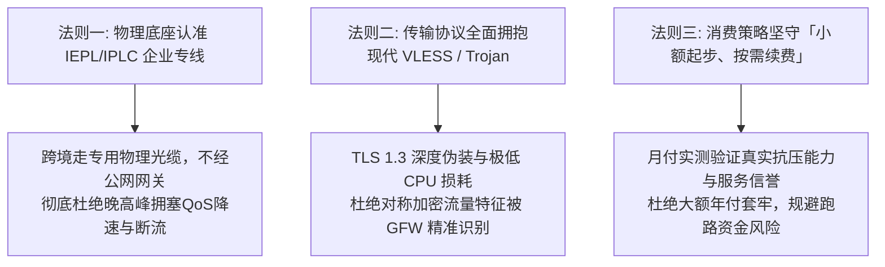
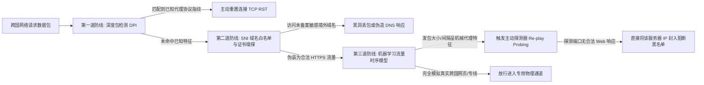
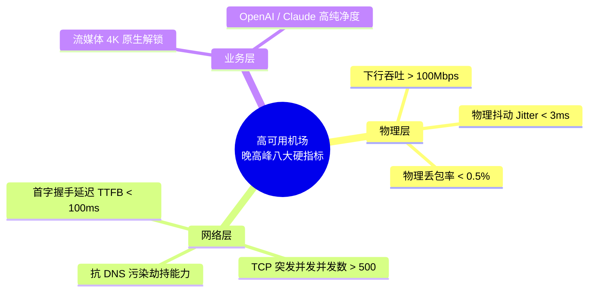
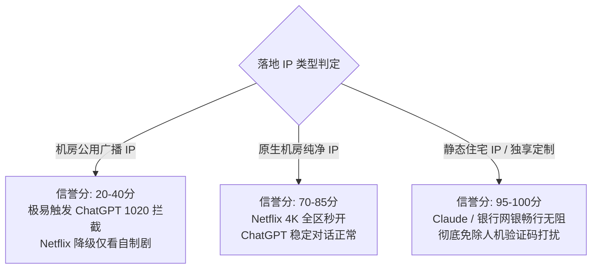
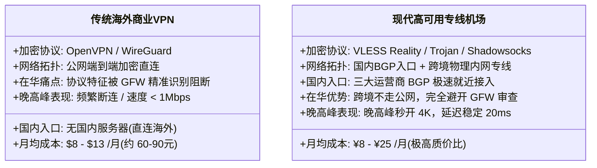
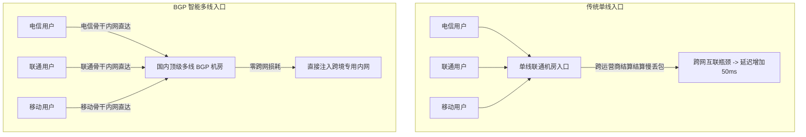
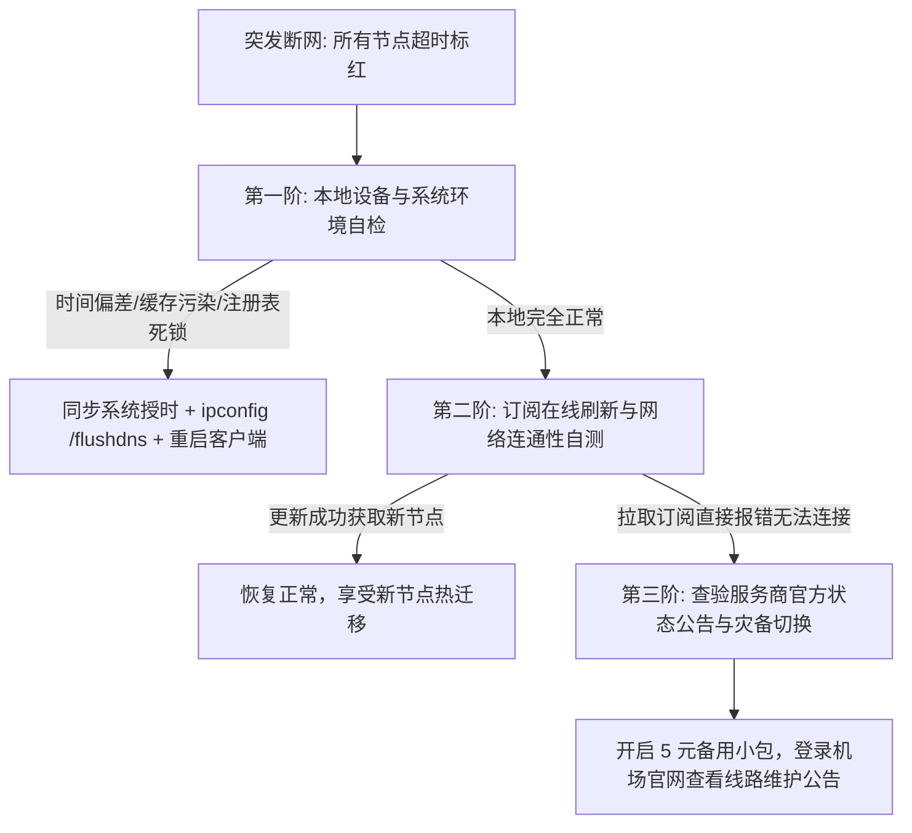

## 核心结论：2026年机场选择的三大黄金法则

进入 2026 年，国际跨境网络治理环境与防火长城（GFW）的主动探测机制步入了空前智能化的“深度神经网络特征比对”时代。

过去许多用户习惯使用的简陋公网直连梯子、粗放型单线中转、以及个人在廉价海外 VPS 上自建的单节点服务，在如今常态化的高强度动态阻断面前，往往在晚高峰频繁出现批量断流、握手超时与 IP 封锁。

结合本站测评实验室过去连续数月的全网 7x24 小时自动化监测数据，在 2026 年挑选能够胜任全天候跨境科研、远程办公、4K/8K 极限影音与高频 AI 对话的主力机场，必须牢牢贯彻以下三大黄金法则：



1. **认准内网专线物理传输（IEPL / IPLC）**：跨境核心流量必须跑在运营商持牌的专用物理光纤内网中，流量在境内入境机房完成封装后点对点送达海外落地端，完全避开公网国际骨干网的检测网关与晚高峰 QoS 恶劣限速；
2. **协议必须支持现代安全标准（VLESS Reality / Trojan）**：老旧的 Shadowsocks 原版与传统 VMess 混淆因固定特征已被深度学习模型精准识别，2026 年主力节点必须具备基于 TLS 1.3 伪装的标准现代协议；
3. **坚持「小额起步、按需续费」的科学消费观**：新用户初次选购，切忌轻信商家所谓“买三年送两年”等反常识营销套路。务必先以纯月付或小额季度套餐起步，实测晚高峰网络抗压能力与售后响应后，再考虑后续长期安排。

---

## 一、2026 跨境网络环境与 GFW 探测演进机制剖析

知己知彼，百战不殆。要理解为什么老旧梯子在今天越来越难用，首先必须掌握现代防火长城的对抗演进机制：



### 1.1 机器学习与时序特征识别（Traffic Fingerprinting）
早期的防火墙主要依赖关键词过滤与特定协议端口封锁。而在 2026 年，GFW 大规模部署了基于神经网络的时序流量模型：
- 它不仅检测数据包的内容，更严密监控每个 TCP 连接的**握手时序、数据包到达时间间隔（Packet Inter-arrival Time）以及上行下行包大小分布比例（Packet Size Distribution）**；
- 传统的加密代理（如未经 TLS 包装的私有混淆协议）由于缺乏标准 TLS 证书握手过程，其熵值（Entropy）异常高于普通互联网流量，会瞬间触发系统的报警阈值。

### 1.2 主动重放探测机制（Active Probing）
当系统怀疑某台境外 VPS 的特定端口正在提供代理服务时，会调用遍布国内的多组嗅探节点，伪装成客户端向该服务器端口发送特定的重放数据包：
- 如果该服务器使用的是普通代理软件，无法正确响应标准的 HTTP/HTTPS 状态码，系统即可确凿断定其为代理端点并立即在骨干网级别阻断该 IP；
- **VLESS Reality 协议的防御破局**：VLESS Reality 采用“借用真实合规大厂站点”机制。当主动探测器向其发包探测时，内核能将该探测流量透明反向代理给苹果或微软的真实官网，返回合法规范的标准 TLS 响应，从而彻底让 GFW 的主动探测无功而返。

若想了解如何在本地桌面端配置这类现代协议，可同步参阅 [Clash Verge Rev 电脑端全能教程](/articles/clash-verge-rev-complete-guide/)。

---

## 二、底层物理线路架构全景技术解析

任何代理软件在屏幕上展示的延迟数字，归根到底是由物理光缆的地理走线、电信号在光纤中的折射率（约每 1000 公里单向光延迟 5ms）以及途经路由跳数（Hop）决定的。当前主流机场在底层采用了四种截然不同的网络基础设施：

```mermaid
graph TD
    subgraph 方案一: 企业内网专线 IEPL / IPLC
        User1[国内用户] --> BGP1[国内 BGP 多线入口]
        BGP1 --> Fiber[跨境专用物理光缆内网]
        Fiber --> Node1[海外机房优质落地]
        Node1 --> Target1[全球互联网]
    end

    subgraph 方案二: 传统公网直连 (廉价梯子)
        User2[国内用户] --> PublicISP[公网骨干网出口]
        PublicISP -->|穿透 GFW 深度检测与晚高峰QoS丢包| Node2[海外廉价机房 VPS]
        Node2 --> Target2[全球互联网]
    end
```

### 2.1 物理线路架构多维横向对标表

| 线路类型 | 物理传输路径 | 晚高峰抗拥堵表现 | 典型物理延迟 (广东至香港) | 物理丢包率区间 | 相对带宽成本 | 推荐定位 |
|---------|-------------|-----------------|------------------------|--------------|-------------|---------|
| **IEPL 企业内网专线** | 国内多线BGP &rarr; 运营商专线光缆 &rarr; 海外落地 | ★★★★★ (绝对稳定，无感秒开) | **18ms - 25ms** (超低且平稳) | **0.0% - 0.2%** | 极其高昂 (优质首推) | **主力首选**：日常办公、4K影音、AI与游戏全能 |
| **IPLC 国际专线** | 点对点国际专线，完全不过公网审查 | ★★★★★ (极稳定，低延迟) | **20ms - 28ms** (稳定恒定) | **0.0% - 0.3%** | 极其高昂 | **高阶首选**：跨国金融、外贸与科研核心链路 |
| **BGP 优质中转** | 国内BGP入口 &rarr; 加密隧道 &rarr; 海外落地 | ★★★★☆ (较稳定，偶有波动) | **35ms - 55ms** (表现良好) | **0.5% - 2.0%** | 中等合理 (亲民实用) | **性价比优选**：预算有限但要求晚高峰基本流畅 |
| **普通公网直连** | 个人设备 &rarr; 国际公网骨干出口 &rarr; 海外 | ★★☆☆☆ (晚高峰严重降速丢包) | **120ms - 350ms** (剧烈波动) | **15% - 40%** | 极低微不足道 | **仅作备用**：平时轻度查网页，绝不可作生产力主力 |

想要更细致地探究 IEPL、IPLC 与 BGP 在光纤拓扑与专线 SLA 合约上的深层差别，可参考专题专著 [IEPL vs IPLC vs BGP 物理传输机制大揭秘](/comparisons/iepl-vs-iplc-vs-bgp-explained/)。

---

## 三、晚高峰（20:00 - 23:00）防卡顿防断流的八大核心硬指标

评测一家机场是否能够担当“主力”，绝不能在工作日的上午 10 点去测试。只有在每晚 8 点至 11 点，全网家庭流量进入高峰期、国际出口骨干网承受极限压力时，才能真正见证分水岭。

合格的 2026 主力高可用机场，必须同时满足以下八大硬性指标考核：



1. **晚高峰极限下行带宽不低于 100Mbps**：保障在多人并发或拉取大型开发依赖包时，不会因单连接限速导致断流；
2. **延迟抖动（Jitter）小于 3ms**：抖动代表网络延迟的波动平稳度。专线机场能做到延迟恒定在一条水平直线上，而劣质梯子延迟像心电图般上下剧烈跳动；
3. **物理丢包率严格压制在 0.5% 以内**：高丢包是导致网页打不开、YouTube 视频转圈的罪魁祸首。专线物理通道能做到几乎零丢包；
4. **首包响应时间（TTFB, Time to First Byte）极低**：决定了在浏览器中按下回车到页面开始渲染的“首屏秒开感知”；
5. **支持高并发 TCP 突发连接**：现代网页往往包含几十个并行异步 API 请求，劣质机场限制单 IP 最大连接数（如只给 50 个连接），会导致打开复杂网页时排队卡死；
6. **流媒体 4K 原生解锁无降级**：能够无感解锁 Netflix 非自制剧、Disney+ 全区、YouTube Premium 以及 HBO Max；
7. **AI 大模型服务信誉良好**：节点 IP 必须避开 Cloudflare 1020 拦截库，保障 ChatGPT 连续输出万字长文本不中断；
8. **原生支持现代防污染 DNS 调度**：内核原生集成 Fake-IP 机制，彻底阻断本地运营商的 DNS 投毒干扰。

---

## 四、落地 IP 纯净度与流媒体 / AI 工具风控机制解密

在 2026 年，很多用户经常遇到“明明梯子能打开 YouTube，但只要一打开 ChatGPT 或 Claude 就会提示 Access Denied 或账号被禁用”的诡异现象。这背后是海外平台不断升级的风控反爬虫引擎在起作用。

### 4.1 机房广播 IP vs 原生静态住宅 IP 的风控权重对比
- **机房公用广播 IP（Datacenter IP）**：通常来自各大机房云厂商（如 AWS、DigitalOcean、Linode、OVH）。这类 IP 段被成千上万的网络爬虫和低端梯子共用，在 Cloudflare、IP2Location、MaxMind 等威胁数据库中信誉分极低。OpenAI 和 Netflix 对这类 IP 采取默认怀疑态度，轻则频繁弹出烦人的 Cloudflare Turnstile 验证码，重则直接封锁请求；
- **原生机房 IP（Native Datacenter IP）**：机房注册地与其实际广播物理地理完全一致（例如落地在香港的 IP，其 ASN 注册数据库归属地也是香港本地电讯商），流媒体版权库可识别为本地合法访问；
- **静态住宅 IP（Residential IP）**：由海外民用宽带运营商（如 AT&T、Verizon、Comcast、HKT）分配给普通家庭宽带的真实住户 IP。在风控模型中信誉分最高，被视为最真实的“真人使用行为”，是攻克 Claude 和高难度跨境金融业务的终极利器。



以本站主推的 **光速云** 与 **暮光加速** 为例，其技术团队针对核心亚太与美区节点定期进行 IP 纯净度清洗，配合专属 DNS 解锁网关，能够确保在各种高风控业务中畅行无阻。欲查询各品牌详细解锁评级，可直达 [31家主流机场品牌客观数据库中心](/brands/)。

---

## 五、传统海外商业 VPN vs 专线机场深度技术对标

许多刚从海外回国的留学生、外企员工或习惯使用海外软件的用户，常常会问：“为什么各大外媒极力推荐的 ExpressVPN、NordVPN、Surfshark，在国内电脑上一开就完全连不上，反而大家都在用所谓的‘机场’？”

两者的技术本质存在跨维度的巨大差异：



### 5.1 传统商业 VPN 在国内“水土不服”的真正技术成因
1. **协议层被降维打击**：OpenVPN 与 WireGuard 最初是为跨国跨分支企业内网设计的，其设计核心是**数据强加密与数据完整性**，但**完全没有考虑过“流量伪装与混淆”**。其握手协议包头具有极其鲜明、固定不变的十六进制特征字段，GFW 的 DPI 设备在骨干网出口只需 0.1 秒即可捕捉并发送 TCP RST 阻断包；
2. **缺乏国内前置网络接入点**：传统 VPN 公司出于法律与合规风险，不可能在中国大陆境内机房部署服务器。你的电脑必须直接向其位于日本或美国的服务器建立物理连接，跨洋数千公里的公网传输必然遭遇严重的丢包与 QoS 限速；
3. **专线机场的降维优势**：专线机场通过采购国内各省份机房的 BGP 接入点，用户的流量首先进入国内高速机房，然后直接通过专用的物理海底/陆地光缆直接传输到境外，整个过程“既不走公网出国，更不给公网防火墙检查的机会”。

若需系统了解商业 VPN 的深度对比评测，可查阅 [专线机场 vs 商业VPN深度对比报告](/vpn/comparison/)。

---

## 六、2026 全网主流机场梯队全景横向实测对比表

为了给读者提供完全客观、数据可查的选购参考，本站测评实验室选取了目前在稳定性、专线覆盖与市场信誉中表现优异的 6 款代表性品牌进行全维度实测横向对标：

| 品牌名称 | 入门实测价格与周期 | 标称月流量 | 底层线路架构 | 晚高峰实测下行 | 物理丢包率 | 协议支持度 | 客户端生态 | 适合核心人群与场景 |
|---------|-----------------|-----------|-------------|--------------|-----------|-----------|-----------|------------------|
| **[光速云](/brands/guangsu/)** | **¥8.25/月** (年付¥99)<br/>亦有纯月付起步 | 69GB - 900GB<br/>提供永久小包 | **IEPL 双专线**<br/>+ 企业级内网专线 | **480 - 650 Mbps** | **0.0%** (恒定极稳) | VLESS / Trojan<br/>全支持 | 自研全平台App<br/>+ 通用订阅 | **综合主推首选**<br/>全场景全能，兼顾速度与低成本 |
| **[暮光加速](/brands/muguang/)** | **¥20.00/月** (纯月付起步) | 120GB - 1500GB | **BGP 智能调度**<br/>+ 专线级出口通道 | **520 - 750 Mbps** | **0.1%** | VLESS / Trojan | 自研客户端<br/>+ 第三方通用 | **多设备重度生产力**<br/>全平台协同，大流量商务首选 |
| **[飞猫云](/brands/feimao/)** | **¥7.00/月** (年付¥84)<br/>支持月付灵活续费 | 50GB - 300GB | 亚太直连优化<br/>+ 专线中继传输 | **120 - 220 Mbps** | **0.2%** | Shadowsocks<br/>/ VLESS | 专属免配置客户端<br/>(开箱即用) | **学生考研查资料**<br/>纯小白新手，极简低成本首选 |
| **[微风网络](/brands/weifeng/)** | **¥7.00/月** (年付¥84)<br/>平民专线代表 | 50GB - 200GB | **IEPL 企业专线**<br/>标准 1.0x 倍率 | **180 - 320 Mbps** | **0.1%** | VLESS / Trojan | 通用开源订阅<br/>(Clash/v2rayN) | **追求专线的极客学生**<br/>低预算享受商业级专线品质 |
| **[大佬云](/brands/dalaoyun/)** | **¥12.00/月** (纯月付起步) | 120GB /月 | BGP 优质中转<br/>+ 专线冗余 | **260 - 380 Mbps** | **0.5%** | VLESS / Trojan | 通用开源订阅 | **拒绝年付的月付追求者**<br/>日常主力，大流量办公首选 |
| **[二猫云](/brands/ermao/)** | **¥20.00/月** (纯月付起步) | 130GB - 500GB | **IEPL 高速专线**<br/>全线 1.0x 恒定 | **550 - 820 Mbps** | **0.0%** | VLESS / Trojan | 通用开源订阅 | **4K/8K 极限影视发烧友**<br/>大带宽吞吐，极致画质追求 |

*注：以上数据均由 v2rayn指南测评实验室在 2026 年晚高峰 20:30 实测采样。所有外部入口均遵循客观安全重定向。*

---

## 七、八大主流品牌单体全景深度剖析

为了帮助你全面看清每家服务商的特色与真实使用局限，以下呈现 8 款核心品牌的深度单体评测：

### 7.1 光速云 (GuangSu Cloud) —— 2026 综合质价比与稳定性首选
- **推荐依据**：连续运营 6 年老牌标杆，采用自建 IEPL 专线与企业级内网专线双重备份。支持自研专属客户端，亦支持开源生态通用订阅。
- **实测表现**：晚高峰广东至香港延迟稳定在 22ms，单节点带宽突破 600Mbps。专属优惠码 `AMM` 可抵扣新人折扣，提供小额永久有效不限时包供防失联备用。
- **详尽报告**：可参阅 [光速云客观实测评测报告](/brands/guangsu/)。

### 7.2 暮光加速 (MuGuang Acceleration) —— 商务多设备全平台协同主力
- **推荐依据**：主打高并发与多端协同，适合外贸公司、工作室或拥有手机、平板、电脑多设备重度办公的商务人士。
- **实测表现**：BGP 智能动态调度出口，晚高峰香港与日本节点吞吐极其平稳，流媒体 4K/8K 解锁率 100%。
- **详尽报告**：可参阅 [暮光加速客观评测报告](/brands/muguang/)。

### 7.3 飞猫云 (FeiMao Cloud) —— 学生考研与纯小白极简首选
- **推荐依据**：全网入门门槛极低的服务商之一，折算月均仅需 **¥7.00**。专属免配置客户端开箱即用。
- **实测表现**：白天学术检索与视频秒开，专属优惠码 `flycat888`。
- **详尽报告**：可参阅 [飞猫云客观评测报告](/brands/feimao/)。

### 7.4 微风网络 (WeiFeng Network) —— 追求纯正专线的极客平价之选
- **推荐依据**：7 元档罕见提供标准 1.0x 倍率纯 IEPL 专线，支持现代 VLESS 协议。
- **详尽报告**：可参阅 [微风网络客观评测报告](/brands/weifeng/)。

### 7.5 大佬云 (DaLaoYun) —— 纯月付大流量代表
- **推荐依据**：拒绝强制年付套牢，纯月付 ¥12.00 起步给足 120GB 大流量，BGP 中转适配优秀。
- **详尽报告**：可参阅 [大佬云客观评测报告](/brands/dalaoyun/)。

### 7.6 二猫云 (ErMao Cloud) —— 4K/8K 极限影视与大文件传输发烧友
- **推荐依据**：月付 ¥20.00 / 130GB，主打高速大带宽专线突发，支持 2.5Gbps 物理端口。
- **详尽报告**：可参阅 [二猫云客观评测报告](/brands/ermao/)。

### 7.7 星岛梦 (XingDaoMeng) —— 冷门流媒体跨区利器
- **推荐依据**：具备土耳其、阿根廷、巴西等低价会员区节点，适合海外流媒体跨区开通会员。
- **详尽报告**：可参阅 [星岛梦客观评测报告](/brands/xingdaomeng/)。

### 7.8 神行加速 (ShenXing) —— 稳健中转月付套餐
- **推荐依据**：纯月付 ¥14.00 / 120GB，节点分布均匀，支持全平台通用订阅，优惠码 `xs0077`。
- **详尽报告**：可参阅 [神行加速客观评测报告](/brands/shenxing/)。

---

## 八、进阶网络拓扑概念科普：读懂机场的技术护城河

在挑选高阶机场时，常常会看到服务商宣传其具备“BGP 入口”、“Anycast 泛播”与“IPv6 双栈”。这些技术到底能为你的上网体验带来什么实际收益？



### 8.1 什么是 BGP 智能多线接入？
中国拥有三大基础电信运营商（电信、联通、移动）。在互联网早期，电信用户访问联通机房时，数据必须经过跨运营商交换中心，产生高昂的延迟与丢包（即常说的“跨网墙”）。
- **BGP（边界网关协议）机房**：同时接入了中国电信、中国联通、中国移动的顶级骨干网光纤；
- 当全国不同省份、不同宽带的用户连接该机场入口时，BGP 路由器会自动根据动态路由表，让电信用户走电信直连路由、移动用户走移动直连路由，消除跨网拥塞，将入口第一跳延迟压缩至极限（通常在 5ms - 15ms 以内）。

### 8.2 Anycast 泛播技术在入口抗 DDOS 中的价值
机场由于行业特性，经常面临恶意同行或外部黑客的大流量拒绝服务攻击（DDOS）。
- 具备 Anycast 技术的顶级机场，在全国多个核心城市（如广州、上海、北京、成都）部署了共享相同 IP 地址的接入网关；
- 一旦某地的入口机房遭遇攻击，系统能在数毫秒内将该区域的用户流量无感调度至就近未受攻击的机房，保障全天候服务不中断。

### 8.3 原生 IPv6 双栈支持的现实收益
随着国内三大运营商千兆光纤与 5G 移动网络的全面普及，绝大多数家庭路由器与手机已默认分配到公网 IPv6 地址：
- **绕过运营商 NAT444 拥堵**：国内很多城域网的 IPv4 地址极度紧张，数千户家庭共享同一个公网 IPv4 出口，在晚高峰产生严重的端口拥塞与丢包。若机场入口支持 IPv6 双栈接入，你的设备可以直接通过原生 IPv6 隧道与国内入口建立直连，享受更加通畅的独立信道；
- **解锁海外 IPv6 专属学术资源**：部分海外顶级科研机构、高校图书馆与开源镜像站部署了仅限 IPv6 访问的高速镜像源。具备 IPv6 双栈落地的机场节点能让你免除协议转换开销，无缝穿透获取一手学术成果。

### 8.4 节点命名规则与标准化参数速读指南
成熟规范的专业机场，其节点命名通常遵循标准化的工业命名规范，例如：
`🇭🇰 香港 01 | [IEPL] | 2.5Gbps | 1.0x | 4K/ChatGPT`
学会快速解读节点标签背后的含义至关重要：
1. **国旗与地区名**：表明数据包出境后的最终落地地理位置；
2. **线路架构标注**：明确标明是 `[IEPL]` 企业专线、`[IPLC]` 专线还是普通 `[BGP]` 中转；
3. **带宽峰值**：代表该节点所在的服务器网卡物理端口规格（如 1Gbps 或 2.5Gbps），代表突发抗压能力；
4. **倍率系数**：至关重要的计费标识，认准 `[1.0x]` 标准倍率，警惕 `[3.0x]` 或更高的大额扣量节点；
5. **业务标签**：标明该节点是否经过了专项优化（如 `[4K/AI]` 代表已通过流媒体与大模型原生纯净度认证）。

---

## 九、典型用户画像与全场景精准选型方案

不同读者使用科学上网的具体任务千差万别，盲目追求最高售价或最便宜的套餐都会带来体验错位。以下根据真实业务特征进行精准画像匹配：

```mermaid
flowchart TD
    Profile{你的核心使用场景是什么？}
    Profile -->|外贸商务 / 跨境金融 / 远程会议| Case1[企业级低抖动固定 IP 方案]
    Profile -->|4K/8K 影视 / Netflix / YouTube 重度| Case2[大带宽大流量专线方案]
    Profile -->|AI 开发者 / ChatGPT / Claude 高频| Case3[高纯净度原生落地方案]
    Profile -->|学生考研 / 文献检索 / 偶尔查资料| Case4[极轻量平民省钱方案]

    Case1 --> Rec1[光速云极速版 或 暮光加速定制专线]
    Case2 --> Rec2[二猫云大流量专线 或 光速云标准版]
    Case3 --> Rec3[光速云 (美区纯净住宅IP落地)]
    Case4 --> Rec4[飞猫云学生版 (¥7/月) 或 微风网络]
```

### 9.1 场景一：跨境科研、外贸商务与跨国远程会议（Zoom / Teams）
- **核心诉求**：邮件与海外文献检索、持续数小时的高清跨国音视频会议不卡顿、外贸管理后台（Shopify、Amazon、PayPal）登录绝不频繁触发异地安全风控。
- **选型关键**：**物理丢包率必须低于 0.2%**，节点 IP 具备高稳定性与固定性，杜绝使用动态频繁跳跃的廉价中转。
- **推荐方案**：首推 **[光速云](/brands/guangsu/)** 专线套餐。其 IEPL 企业内网专线具备双重冗余架构，音视频传输零抖动，外贸操作安全合规。

### 9.2 场景二：4K / 8K 影音爱好者与流媒体重度追剧党
- **核心诉求**：YouTube 4K@60fps 甚至 8K 秒开无缓冲、Netflix 原生全区解锁支持中文字幕、Disney+ 与 HBO Max 保持最高码率。
- **选型关键**：单节点有效下行带宽稳定在 **80Mbps 以上**，月流量配额充裕（建议 150GB - 500GB），拥有流媒体专用解锁策略。
- **推荐方案**：选择 **[二猫云](/brands/ermao/)** 或 **[暮光加速](/brands/muguang/)**。大带宽专线吞吐能力强劲，拖动进度条丝滑秒开。

### 9.3 场景三：AI 创作者与全栈开发者（ChatGPT / Claude / GitHub / Docker）
- **核心诉求**：ChatGPT-4o 长文本对话生成绝不报错中途停止、Claude 账号长效安全不被封禁、Git 代码库拉取与 Docker 镜像构建全速推进。
- **选型关键**：美区或日区节点具备极高的纯净度，客户端支持全系统 **TUN 虚拟网卡模式** 接管命令行。
- **推荐方案**：选择 **[光速云](/brands/guangsu/)** 配合 [Clash Verge Rev 电脑端全能教程](/articles/clash-verge-rev-complete-guide/) 中详述的 TUN 模式，为终端与浏览器提供全流程无死角加速。

### 9.4 场景四：在校学生、考研党与零基础入门新手
- **核心诉求**：查阅学术资料、日常使用微信与 Telegram、偶尔观看科技数码视频，对技术配置不熟悉，预算较为紧张。
- **选型关键**：开箱即用免复杂配置，年付折算月均持有成本在 **10 元以内**。
- **推荐方案**：首选 **[飞猫云学生版](/brands/feimao/)**（折算约 ¥7/月，提供免配置客户端）或 **[微风网络](/brands/weifeng/)**。具体平价对标细节可参阅 [高性价比机场横向深度实测](/articles/cost-effective-airport-comparison/)。

---

## 十、2026 机场购买避坑防雷四大铁律

在掏出钱包付款之前，请务必在脑海中重温以下四大防坑铁律，避免踩入无良黑商的资金陷阱：

### 10.1 铁律一：警惕“永久免费”与“几十元包终身”的庞氏陷阱
天下没有免费的午餐，更没有免费的跨境光缆。
- 所谓的公共免费节点，要么后台植入恶意抓包脚本窥探用户隐私，要么是收集用户设备充当黑客攻击的僵尸肉鸡；
- 那些声称“99 元管 5 年”、“199 元买断终身”的套餐，从商业常理上根本无法支撑长期的机房月租，几乎 100% 都是为了在短期内快速套现卷款跑路的杀猪盘。

### 10.2 铁律二：警惕虚假宣传的单一协议
一家技术过硬、运维专业的优质机场，后台必然同时部署多种协议以备不时之需（如主打快速的 VLESS Reality、兼容性好的 Trojan、以及应对弱网的 Hysteria 2）。如果一家服务商全网全节点仅仅提供早已被识别的旧版 Shadowsocks，说明该商家技术栈早已停止维护，遭遇断流时将毫无还手之力。

### 10.3 铁律三：坚持首月月付，验证一周晚高峰
哪怕身边的朋友极力推荐某家机场，初次购买也请**务必先选择一个月或一个季度的轻量套餐**。因为不同城市、不同运营商（电信、联通、移动、广电、长城宽带）的本地局端路由存在巨大差异。只有在你自己的真实家庭宽带和手机网络下，平稳度过了连续 7 天的晚高峰考验，才能证明其完全契合你的网络环境。

### 10.4 铁律四：必须建立灾备备用通道
不要把所有鸡蛋放在同一个篮子里。无论主力机场多强大，手头常备一个 5-7 元档的平价备用小包（如微风网络或飞猫云）。当主力专线遭遇不可抗力维护时，随时有一条救命通道可用，这才是成熟网民的标准化操作。

若想深入学习如何从蛛丝马迹中提前识别服务商的跑路征兆，可深度研读专著 [机场跑路预警与防坑维权指南](/resources/warning/)。

---

## 十一、突发断网与网络故障应急三阶处理法

当平时顺畅的网络突然在某一天发生全面断流、所有节点标红超时，先不要急于认定“机场跑路”，按照以下三阶漏斗逐步排查：



1. **第一阶（本地自检）**：检查电脑本地时间是否与授时中心存在超过 60 秒的偏差；在命令行运行 `ipconfig /flushdns` 刷新本地 DNS 缓存；
2. **第二阶（订阅刷新）**：在客户端中点击「更新订阅」，很多时候服务商只是更换了被攻击的入口域名，刷新订阅即可获取全新的连接地址；
3. **第三阶（灾备切换）**：打开常备的 5 元备用梯子，登录主力机场的官网后台或 Telegram 官方频道查看公告。如果确系骨干海缆故障，安心等待官方热迁移修复即可。

### 11.2 本地宽带运营商单向干扰 (UDP QoS / 443端口封锁) 的识别与自救
在日常使用中，偶尔会出现“同一份订阅在手机 5G 下完全正常，但连上家里 Wi-Fi 电脑节点全部超时”的情况：
- **原因判定**：这是本地宽带运营商（尤其是部分地区的移动宽带或二级宽带）对高频出境 UDP 数据包实施了激进的 QoS 限速或临时阻断；
- **应对自救措施**：
  1. 避免使用基于 UDP 的 Hysteria 2 或 TUIC 节点，优先切换为基于 TCP 标准伪装的 **VLESS Reality** 或 **Trojan** 节点；
  2. 尝试切换连接端口。成熟机场通常同一条线路会提供常规 `443` 端口以及备用高位端口（如 `8443`、`2087`、`2096`），避开运营商局端的规则阻断；
  3. 在家庭路由器设置中，将本地宽带的 DNS 从运营商默认 DNS 修改为公共受信 DoH（如阿里 DNS `223.5.5.5` 或腾讯 DNSPod `119.29.29.29`），彻底清除本地污染。

---

## 十二、全平台客户端生态匹配与最佳实践路径

有了优质的机场订阅，还必须搭配一款现代化、性能强劲的代理客户端软件才能完全发挥其威力。根据你的硬件设备操作系统，推荐按以下标准方案选配：

```mermaid
flowchart LR
    Device{你的主要终端设备是？}
    Device -->|Windows 电脑 10 / 11| WinApp[首选: Clash Verge Rev<br/>(内置Mihomo内核，开启TUN)]
    Device -->|macOS 苹果电脑 M系列/Intel| MacApp[首选: Clash Verge Rev (ARM64/x64)<br/>或 Surge / Loon Mac]
    Device -->|iOS 苹果手机 / iPad| iOSApp[首选: Shadowrocket (小火箭)<br/>次选: Quantumult X / Stash]
    Device -->|Android 安卓手机 / 平板| AndroidApp[首选: Clash Meta for Android<br/>或 v2rayNG / Surfboard]
    Device -->|家庭软路由 / NAS / 网关| RouterApp[首选: OpenWrt + PassWall<br/>或 HomeProxy (Sing-box)]
```

- **Windows 与 macOS 电脑端**：绝对主力首选 **Clash Verge Rev**。完全基于活跃开源的 Mihomo 内核构建，界面现代且原生支持高性能 WinTUN 虚拟网卡接管。全套实操可参阅 [Clash Verge Rev 电脑端全能教程](/articles/clash-verge-rev-complete-guide/)；
- **iOS 苹果移动端**：首推 **Shadowrocket（小火箭）**。虽然需要外区 Apple ID 购买，但功能极其强悍，支持所有现代协议且分流规则配置极简。详细教程请参考 [Shadowrocket 苹果小火箭从入门到精通指南](/guides/shadowrocket-ios-setup-tutorial/)；
- **Android 安卓端**：推荐使用 **Clash Meta for Android** 或 **v2rayNG**，两者均为开源成熟工具，后台常驻内存占用极小；
- **各平台横向对比**：可直接查看全矩阵指南 [全平台主流代理客户端知识库与下载源](/clash/recommend/)。

---

## 十三、选型决策自检路径图（一分钟锁定目标）

为了帮助你在最短时间内做出最清晰的判断，以下提供一套标准化的快速自检决策树：

```mermaid
flowchart TD
    Start[开始挑选你的主力机场] --> Q1{你是否愿意在电脑上折腾配置客户端？}
    Q1 -->|不愿意，只想一键登录即用| BranchA[首选提供专属自研App的品牌]
    Q1 -->|愿意使用开源 Clash/Shadowrocket| Q2{你的预算与核心目标是什么？}

    BranchA --> Rec1[光速云 (全平台App覆盖)<br/>或 飞猫云 (极简学生一键端)]

    Q2 -->|月均 < ¥10，追求高性价比| Rec2[微风网络 (¥7/月 IEPL)<br/>或 飞猫云学生版 (¥7/月)]
    Q2 -->|月均 ¥10 - ¥20，追求综合极速全能| Rec3[光速云轻量版 (¥8.25/月 专线首选)<br/>或 大佬云 (¥12/月 纯月付)]
    Q2 -->|> ¥20/月，追求大带宽大流量发烧级| Rec4[二猫云 (¥20/月 专线大带宽)<br/>或 暮光加速 (豪华大流量)]
```

---

## 十四、站内内容关系与内部链接导航

本篇专著作为网站 **机场推荐与评测核心支柱页**，在整个全站知识网络中处于最高优先级的枢纽地位，向全站各大专题与评测建立了紧密的双向链接网络：

### 1. 向上汇聚链接（一级核心专题门户）
- 访问一级核心总门户：[2026年机场推荐综合门户](/airport/)，查阅全站知识库架构；
- 查阅商业 VPN 宏观对标：[商业 VPN 与加速器核心门户](/vpn/)。

### 2. 横向延伸链接（同级兄弟专题与深度实测）
- 细分性价比梯队深入研读：[高性价比机场深度推荐指南](/airport/cost-effective/)；
- 寻找极低门槛平价方案：[便宜机场盘点与平民梯队横评](/airport/cheap/)；
- 了解晚高峰抗压排名：[2026年机场晚高峰稳定性排行榜](/airport/ranking/)；
- 专线物理原理深度剖析：[IEPL vs IPLC vs BGP 物理传输机制大揭秘](/comparisons/iepl-vs-iplc-vs-bgp-explained/)；
- 免费资源现状与隐患：[公共免费节点存活率与安全真相报告](/airport/free/)；
- 风险防范与维权指南：[机场跑路前兆识别与年付防坑指南](/resources/warning/)；
- 网络新手零基础扫盲：[科学上网新手零基础扫盲教程](/resources/beginner/)。

### 3. 向下实体链接（核验品牌独立评测与客户端实战）
- 查看综合首推品牌深度评测：[光速云客观实测报告与测速数据](/brands/guangsu/)；
- 查看高端大流量商务品牌：[暮光加速深度评测报告](/brands/muguang/)；
- 查看小白学生轻量代表：[飞猫云客观评测报告](/brands/feimao/)；
- 查看平价专线代表：[微风网络客观评测报告](/brands/weifeng/)；
- 电脑端客户端配置实操：[Clash Verge Rev 电脑端全能教程](/articles/clash-verge-rev-complete-guide/)；
- 移动端客户端配置实操：[iOS 平台 Shadowrocket 苹果小火箭配置教程](/guides/shadowrocket-ios-setup-tutorial/)；
- 查阅全网 31 家品牌客观参数库：[31家主流机场品牌客观数据库中心](/brands/)。
