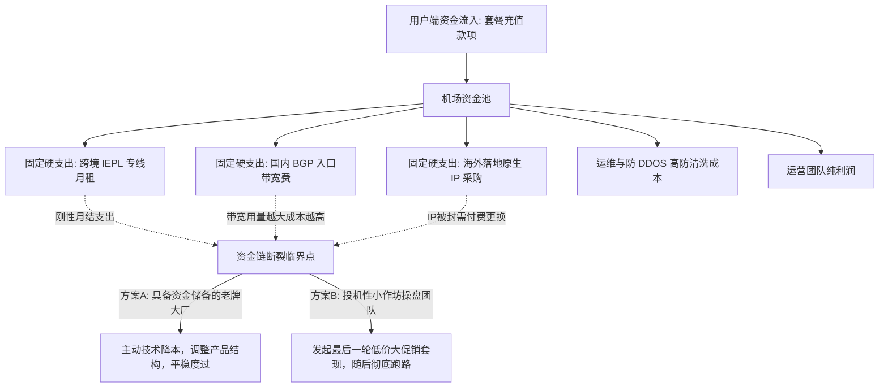
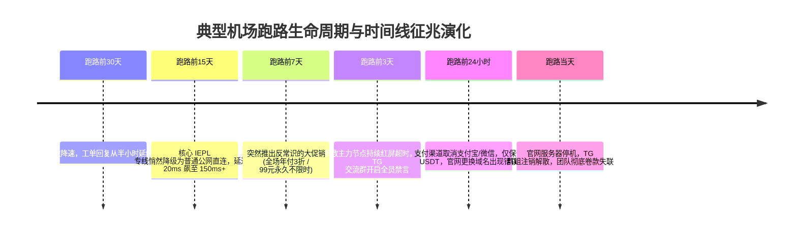
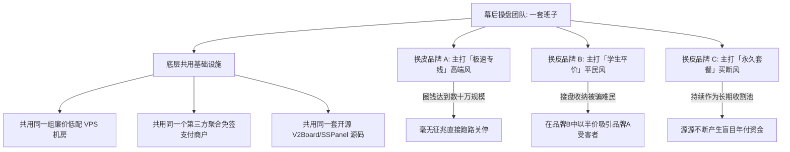
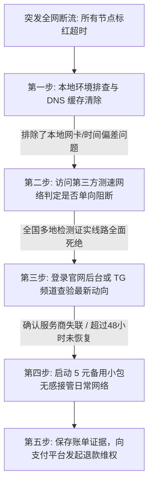
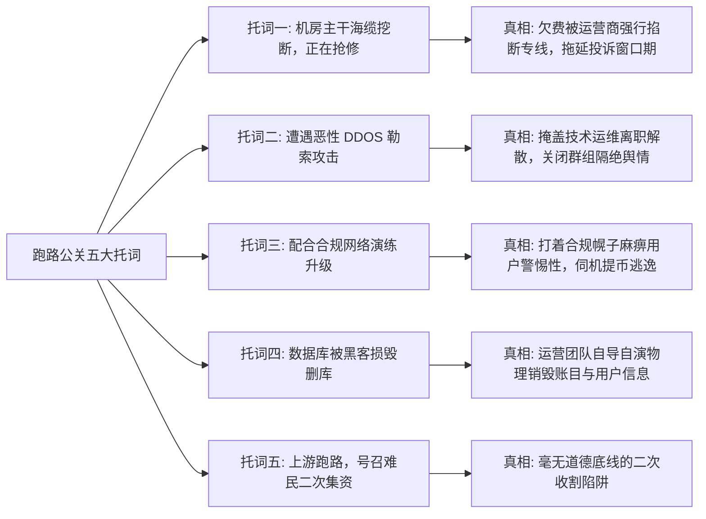

## 核心法则：为什么机场跑路在行业中屡见不鲜？

在繁荣与乱象并存的跨境网络代理行业中，“机场跑路”从来不是偶然发生的罕见个案，而是每天都在不同角落真实上演的高频事件。

很多刚刚涉足科学上网的新手用户常常抱有天真的幻想，认为自己在网上精挑细选了一家“官网设计炫酷、套餐极其便宜、客服秒回”的宝藏服务商，以为只要一次性交上几十元或上百元的年费，未来两三年就能高枕无忧地享受千兆高速网络。然而，残酷的现实往往在几个月甚至几周后便狠狠敲响警钟：**某天早晨醒来，客户端节点全部标红超时，打开官网显示 404 Not Found 或域名被暂停解析，进入官方 Telegram 群组发现已被全员禁言甚至整个群组人间蒸发——服务商彻底失联跑路了**。

深入透视这个行业的底层商业逻辑，机场跑路的本质是**物理刚性成本与失控定价模型之间的必然破产**。没有任何一家商业机构可以对抗基本的经济学规律：
- 优质的跨境物理专线（IEPL / IPLC）、国内顶级 BGP 入口机房、海外原生住宅 IP 的月度租赁费用都是极其高昂且必须按月真金白银结算的硬性开支；
- 绝大多数缺乏技术底蕴的小作坊服务商，在激烈的市场竞争中只能依赖无底线的价格战（如“5元包月500G”、“年付30元送1000G”）来吸引小白用户；
- 这种“以超低价吸纳大额年付资金”的模式，本质上就是典型的**庞氏骗局与资金链击鼓传花**。前期的年付预收款很快被操盘手挥霍一空，当后续没有源源不断的新用户涌入时，服务商每月微薄的新增收入根本无法覆盖庞大的服务器续费账单，最终唯一的结局就是卷款跑路、关服失联。

本文作为本站测评实验室历时数月深度打磨的权威风控专著，将彻底拆解机场跑路背后的黑幕与套路，为你构筑一道全方位的资金安全与网络自救防线。

---

## 一、机场运营成本与资金链断裂模型深度剖析

要做到在风险来临前具备敏锐的嗅觉，首先必须像精算的财务审计师一样，看懂一家代理服务商的收支账本。



### 1.1 刚性物理支出：为何低价必然走向崩溃？
以一个拥有 2,000 名活跃用户的中小型机场为例，维持其基本网络畅通的每月硬性开支包括：
1. **跨境专用内网专线带宽（IEPL/IPLC）**：按照晚高峰保底 1Gbps 的峰值带宽计算，企业级专线的每 Mbps 月租金在 30-50 元左右，仅此一项每月就要耗费 **3 万至 5 万元人民币**；
2. **国内三网多线 BGP 入口**：部署在江苏、浙江、广东等地顶级机房的高防入口服务器，单台月租加防护带宽在 **5,000 - 10,000 元**；
3. **海外多地区落地原生 IP 与流媒体解锁网关**：覆盖香港、日本、新加坡、美国的主流机房，采购纯净住宅 IP 与维护 DNS 解锁，每月开销不低于 **3,000 - 8,000 元**。

**合计每月刚性成本在 4 万至 7 万元之间**。如果该机场主推的是“年付 60 元（折合每月仅 5 元）”的低价套餐，2,000 名用户的年费总收入只有 12 万元，平均到每个月只有 1 万元的资金流入。**收支倒挂高达数倍！**
这类小作坊唯一的存活方式就是**无限度超售（Over-selling）**：把 1Gbps 的带宽卖给 10,000 个人，导致晚高峰人人卡顿。一旦超售达到物理极限遭致全网声讨，或是敏感时期上游机房追缴专线尾款，运营团队账面上早已没有现金，除了跑路别无选择。

想要深入理解专线物理成本与公网中转的悬殊差距，可参考专题专著 [IEPL与IPLC专线深度技术解析](/comparisons/iepl-vs-iplc-vs-bgp-explained/)。

---

## 二、机场跑路前不可逆的七大早期致命征兆

任何一个机场的崩盘与跑路都不是一瞬间突然决定的，在操盘团队做出卷款逃逸的最终决策前，必然会经历资金周转困难、技术失控与心理崩溃的发展过程。只要掌握以下七大特征，便能在其跑路前 7-14 天提前察觉并果断抽身：



### 2.1 征兆一：突然开启违背常识的“骨折级大促”
这是最直观、也是准确率高达 95% 以上的致命回光返照：
- 平时折扣非常严格的服务商，突然在官网和 Telegram 频道铺天盖地推送：“庆祝开业五周年，全场年付一折起”、“充值三年送两年”、“限时 ¥99 抢购永久有效 2000GB 传家宝套餐”；
- **心理学黑幕**：运营者自知下个月已无力支付昂贵的服务器账单，决定在关服前最后疯狂收割一波年付现金流，能骗多少是多少，钱一旦到手立即提币消失。

### 2.2 征兆二：Telegram 讨论群开启全员禁言或关闭评论
正常运营的健康机场，其官方 Telegram 交流群是用户日常交流测速、反馈故障的核心社区。
- 当管理团队突然以“防止恶意刷屏”、“整顿广告黑产”、“近期敏感时期配合风控”为由，**永久关闭群组发言权限、将群组转为单向广播频道、或关闭频道下方的评论功能**；
- 这说明大面积节点故障已经爆发，运营团队为了防止恐慌情绪蔓延导致新用户不敢付款，通过信息黑幕剥夺用户的知情权。

### 2.3 征兆三：核心高成本专线悄悄降级为劣质公网直连
很多用户平时不看测速报告，只凭直觉上网。
- 原本在客户端内延迟稳定在 20ms-30ms 的 IEPL 企业专线，突然延迟飙升至 160ms-280ms，且在晚高峰疯狂丢包（丢包率突破 20%）；
- 抓包查看底层出口 IP，发现原有的专业跨国光纤通道已经被偷偷撤下，换成了月租几十块钱的廉价公网直连 VPS；
- 这表明**服务商与上游电信运营商的专线合同已经到期违约断约**，为了维持表面上的连通，用最便宜的垃圾线路强撑门面。

### 2.4 征兆四：技术工单陷入无休止的拖延与瘫痪
- 以前提交工单通常 15-30 分钟内就有技术人员响应并解决；
- 现在提交工单，状态持续数天处于“待处理 (Pending)”，即使回复也是答非所问的机器人自动模板（如“正在排查，请耐心等待”），人工运维团队实际上已经离职解散。

### 2.5 征兆五：支付方式悄然改变，仅保留匿名 USDT 虚拟币
在早中期，为了方便大众消费，机场普遍支持支付宝、微信扫码支付。
- 当某一天你发现结算收银台突然下线了所有国内免签聚合通道，仅剩下波场 USDT-TRC20 虚拟货币转账；
- 这意味着两个危险信号：第一是其国内第三方支付商户号因涉诈或客诉率过高已被封禁；第二是操盘手准备彻底洗白资金断绝国内银行流水线索，为随时携款跑路做准备。

### 2.6 征兆六：官网频繁更换后缀极其生僻的廉价域名
当原有的稳定 `.com` 或 `.net` 域名突然失联，官网在几天之内频繁切换为 `.top`、`.xyz`、`.work` 等一两块钱就能注册的垃圾域名，且网页上多处静态资源加载失败。

### 2.7 征兆七：核心管理人员账号变色或注销
在 Telegram 群管列表中，拥有 Owner 或 Admin 头衔的核心创办人账号突然注销变成“Deleted Account”，由刚注册的陌生小号接管发言。

---

## 三、行业灰黑产套路揭秘：“马甲站”与流水线跑路黑幕

在网络代理灰产圈，很多你以为是“完全独立竞争的两家机场”，其背后的操盘团队可能根本就是同一个人。这种模式在行业内被称为**“流水线马甲站套现模型”**：



### 3.1 换皮不换药的工业化量产
- 幕后黑心团队花几百块钱购买一套成熟的机场前端模板，配置好自动化发卡与部署脚本；
- 换个 Logo、改一套配色、起一个富有科技感的名字，就可以在 2 个小时内批量克隆出 5 家新机场；
- 他们在各大贴吧、知乎、V2EX 和 Telegram 羊毛群疯狂撒网买广告，以极其诱人的低价吸引大批缺乏鉴别能力的新人购买年付；
- **周期性收割**：每当一个品牌的年费资金池累计到几十万元时，操盘团队便直接拔掉服务器电源，宣布“因不可抗力关停”，整个团队立刻换上另一个早就备好的马甲站继续行骗。

### 3.2 识别同系马甲站的四大实战技巧
1. **对比节点名称命名风格**：小作坊的配置习惯往往带有强烈的个人印记。如果两家不同名字的机场，其节点名称里的标点符号、国家 Emoji 顺序、甚至错别字完全一致，大概率系出同门；
2. **抓取入口服务器 IP 的 ASN 归属**：使用检测工具查询其入口域名解析出的 IP，如果两家机场使用的是同一个机房同一 C 段的连号 IP，其底层线路属于高度共用；
3. **观察支付结算商户名称**：在进入支付宝付款收银台前，看清页面展示的代收款商户名称（如“某某商贸行”或“某某科技工作室”）。如果换了一家机场结算，跳转出来的收款方名称完全一样，确属同一套马甲；
4. **比对用户协议与售后条款文案**：马甲站的常见问题 FAQ 和服务条款通常直接全盘抄袭，甚至连原站点的名字都忘记完全替换干净。

---

## 四、资金安全与个人隐私自我防护实务

很多用户只关注自己的几十元套餐费是否会打水漂，却完全忽视了**更昂贵的个人身份与隐私泄露代价**。不规范的小作坊站点在被执法部门查处或遭受黑客脱库攻击时，用户的真实数据往往会被赤裸裸地挂在暗网贩售。

### 4.1 支付通道风险：警惕连带封号与自动扣费
- **拒绝签署任何形式的「自动续费/免密扣款」协议**：
  在支付结算时，务必看清收银台选项，严禁勾选“每月自动代扣”。一旦服务商跑路，很多不良聚合支付系统依然会在后台每月向你的账户发起无感自动扣款，许多用户在断网两三个月后才发现银行卡依然在被扣钱；
- **防范个人支付账户被风控打标**：
  与涉诈高危商户频繁转账会导致你的个人支付宝被反洗钱系统标记。如果可以，优先使用无绑定个人真实身份的外币虚拟卡或信誉卓著的大品牌结算。

### 4.2 注册信息脱敏与密码防撞库法则
许多人为了图省事，在所有网站使用完全相同的账号密码，这是极其致命的危险习惯：
1. **邮箱脱敏**：绝不可使用包含个人真实姓名拼音、出生年份、手机号、或学校单位域名的主力邮箱（如 QQ 邮箱、163 邮箱、教育网 `.edu` 邮箱）。推荐使用纯海外匿名邮箱（如 ProtonMail、Skiff）或专门申请一个没有任何个人痕迹的备用 Gmail；
2. **密码绝不复用**：为机场账号生成完全随机的 16 位以上强密码（如借助 Bitwarden 或 1Password 生成并保存）。小机场数据库通常未对密码进行严密的加盐哈希（Salted Hash）处理，黑客脱库后可轻松获取明文，进而对你的微信、支付宝、网银发起撞库攻击；
3. **严禁在客户端内同步个人私密文件**：在 [Clash Verge Rev 电脑端全能教程](/articles/clash-verge-rev-complete-guide/) 中配置好规则模式，杜绝将境内银行应用或敏感政务系统的流量误送入不受信任的第三方代理节点。

---

## 五、突发失联！节点大面积阵亡时的五步紧急自救 SOP

当某一天你发现电脑和手机突然无法翻墙、所有节点均变红超时，千万不要手忙脚乱在网上病急乱投医，严格按照以下五步标准化作业程序（SOP）进行冷静处置：



### 5.1 第一步：排除本地与运营商局端故障（避免虚惊一场）
在认定服务商跑路前，首先确保不是自己电脑的问题：
1. **检查系统授时**：按下 `Win + R` 输入 `timedate.cpl`，点击 Internet 时间立即同步。时间偏差超过 60 秒会导致所有节点的 TLS 握手瞬间失败；
2. **刷新本地 DNS 与清除代理残留**：以管理员身份打开 CMD，执行：
   ```cmd
   ipconfig /flushdns
   netsh winsock reset
   ```
3. **切换网络环境测试**：关闭 Wi-Fi，将电脑连接手机 5G 热点。如果手机热点下能连通而家里宽带连不上，说明只是本地宽带运营商局端临时抽风，并非机场跑路。

### 5.2 第二步：第三方客观证据固化（为维权准备材料）
使用站长工具或 Ping.pe，输入机场给你的节点连接域名。如果检测显示全国三大运营商的所有检测点全部标红，且丢包率为 100%，立即将该测试结果页面完整截图保存；
同时在客户端连接日志面板中，截取带有 `connection refused` 或 `timeout` 的报错代码界面备用。

### 5.3 第三步：尝试登录免翻墙官方备用镜像
正规大厂在遭遇主域名被防火墙封锁时，通常会在 1-2 小时内启用备用域名。
- 查看你当初注册时收到的迎新邮件，尝试通过邮件里列出的海外备用登录地址登录后台；
- 查看官方 Telegram 频道或推特账号，确认是否有“正在进行光纤割接或机房迁移”的官方公告。

### 5.4 第四步：启动双机场灾备方案（保障工作不掉线）
成熟的网民手头必须永远备有第二条独立通道。打开常备的 5-7 元/月轻量备用小包（如微风网络或飞猫云），在客户端中切换至备用节点。数秒内网络即可全面恢复，确保紧急外贸业务、跨国会议或代码提交绝不受阻。

### 5.5 第五步：支付争议申诉与挽回损失（实操全流程）
如果经过 48 小时以上观察，确认服务商彻底跑路关群，按照以下流程挽回资金：
1. **查找付款账单详情**：打开微信支付或支付宝，在账单明细中找到当初购买该套餐的扣款记录；
2. **提取商户订单号与收款机构**：记下“商户订单号”以及具体的收款单位名称；
3. **发起交易争议投诉**：
   - 在微信支付该笔账单下方点击「对订单有疑问」->「投诉商户」-> 选择「未收到货 / 商家失联退款难」；
   - 在支付宝账单详情点击「对此订单有疑问」->「投诉」-> 选择「假冒仿冒 / 虚假服务 / 商家不履行承诺」；
4. **上传扎实的证据链**：
   - 附上机场官网无法访问的 404 截图；
   - 附上 Telegram 群组全员禁言或群组被销毁的截图；
   - 附上第三方全网测速丢包 100% 的不可达截图；
   - 附上你在后台提交工单数天无人理睬的界面。
5. **平台介入的底层逻辑**：第三方免签聚合支付公司为了防止受到央行和反洗钱部门处罚，其后台商户账户中普遍留有数万元的**风险保证金**。只要用户的证据确凿且投诉数量形成规模，支付平台会判定商户欺诈违约，直接划扣商户的保证金为投诉用户办理退款！很多掌握此技能的用户成功追回了刚付款不久的损失。

---

## 六、跑路团队惯用的五大心理公关托词深度拆解

在实施跑路的全过程中，黑心运营团队往往具备极强的心理博弈手段。他们深谙大多数普通用户“心存侥幸、不愿相信几十上百元打了水漂”的弱点，在失联前的最后阶段编织各种谎言，以拖延时间、阻止用户向支付平台投诉：



### 6.1 托词一：“上游机房光缆遭遇不可抗力断裂，正在协调抢修”
- **话术伪装**：在频道中煞有介事地贴出某张所谓的“海缆中断施工图”，声称“因极端天气导致国际海缆受损，预计 3-5 个工作日内恢复，请大家稍安勿躁”。
- **残酷真相**：这不过是运营团队为了拖过支付平台 7 天无理由争议申诉期的经典拖延战术。一旦过了申诉期，用户在微信或支付宝端无法再发起快速退款，操盘手便可从容地将资金池全额提现至海外加密货币钱包。

### 6.2 托词二：“遭遇同行大流量恶意 DDOS 攻击，暂时关闭群组和工单”
- **话术伪装**：“由于本站性价比太高招致同行眼红，正在承受 500Gbps 流量轰炸，为了防止内鬼混入，暂时开启全员禁言，恢复时间另行通知”。
- **残酷真相**：同行竞争固然存在，但正规具备高防体系的服务商通常在 1-2 小时内即可通过 Anycast 流量清洗恢复通信。关闭全员禁言的唯一真实目的，是为了**切断受害者之间的横向联络，阻止群体维权声势的形成**。

### 6.3 托词三：“配合网络安全审查，全面进行底层架构合规升级”
- **话术伪装**：打着“为了长治久安，正在将所有老旧节点升级为全新的下一代加密专线”的崇高旗号。
- **残酷真相**：合规审查一旦介入，涉案小作坊早已被连根拔起，哪来所谓的“技术升级”？这纯粹是运营者安抚用户情绪、为自己争取清理痕迹和转账逃跑时间的缓兵之计。

### 6.4 托词四：“数据库遭遇勒索病毒攻击，数据丢失正在抢救”
- **话术伪装**：“黑客入侵了我们的主数据库，加密了所有用户的订阅与余额，技术团队正在通宵进行数据解密和节点重组”。
- **残酷真相**：绝大多数情况下，这是运营团队自导自演的“自残式脱罪话术”。他们自己删除了用户数据库和订单记录，对外声称是受害者，不仅彻底赖掉了用户的未到期余额，更为关服跑路洗清道德负罪感。

### 6.5 托词五：“上游批发商跑路我们也是受害者，老用户加钱协助重组”
- **话术伪装**：这是最为恶劣的**“二次连环收割”**。声称上游机房卷款失联，但只要老用户每人再补交 20-30 元“线路重组基金”，即可重新激活原来剩余的全部年付时长。
- **残酷真相**：很多已被套牢的用户抱着“已经亏了 100，再交 20 试试能不能捞回来”的赌徒心理追加付款，结果这笔重组款项在几天后再度被黑产操盘团队全盘卷走。

---

## 七、跑路后个人数据泄露的二次侵害防范与安全加固

很多用户在遭遇机场跑路后，往往只觉得自己亏了百八十块钱自认倒霉，却浑然不知更严重的**长尾安全隐患**正在悄然滋生：
- 跑路团队在弃站失联后，其服务器中留存的用户数据库（包含成千上万条用户的注册邮箱、明文/弱哈希密码、绑定的 Telegram 账号甚至充值时留下的支付订单信息）往往会被幕后人员直接打包挂在暗网黑市、Telegram 泄密频道中以几百元的价格贱卖；
- 专业的黑产团伙在低价收购这些脱库数据后，会利用自动化脚本对各大互联网平台发起**大规模撞库攻击（Credential Stuffing）**。

### 7.1 第一步：安全核查个人邮箱是否已在暗网泄密库中
1. 访问全球公认的权威数据泄露核验平台 **Have I Been Pwned (HIBP)**；
2. 输入你当初注册小机场时使用的邮箱地址；
3. 如果查询结果标红，系统会清楚列出该邮箱在哪些历史数据泄露事件中被波及，是否包含密码明文或电话号码。

### 7.2 第二步：断绝跨平台撞库风险（实施全量密码重置）
- 如果你曾经在不同网站（如苹果 Apple ID、Steam 游戏账号、个人常用邮箱、网盘）使用了与该机场完全相同或相似的密码，**必须立即、无条件登录这些核心平台，全量修改为全新独立的强随机密码**；
- 建议全面弃用“纯靠大脑记忆简单密码”的危险方式，改用受信任的开源本地或端到端加密密码管理器（如 Bitwarden 或 KeePassXC）。

### 7.3 第三步：为所有核心平台开启双重多因素认证 (2FA / TOTP)
仅仅依靠密码早已无法抵御现代黑客的暴力破解与撞库攻击：
- 立即进入你的主力邮箱（如 Gmail、Outlook、163 邮箱）和重要资产平台设置中，开启基于时间戳的动态口令双重验证（TOTP）；
- 使用手机端身份验证器（如 Google Authenticator、Microsoft Authenticator 或 Aegis），这样即使黑客在脱库后获得了你的真实邮箱和正确密码，在没有你随身手机动态验证码的情况下，依然被彻底挡在门外。

---

## 八、科学防坑消费四象限法则

为了从根源上杜绝成为待宰的羔羊，建立一套健康、理性的科学上网消费准则是长治久安的基石：

```mermaid
quadrantChart
    title 科学上网消费策略四象限风控矩阵
    x-axis 极低资金风险 (月付/轻量试水) --> 极高资金风险 (大额年付/永久买断)
    y-axis 低可用性 / 易断流 --> 高可用性 / 极速抗晚高峰
    quadrant-1 极度危险 (跑路重灾区): 避坑红线
    quadrant-2 最理智决策 (平民专线/月付试水): 强烈推荐
    quadrant-3 临时过渡 (极低成本公网备用): 仅作应急
    quadrant-4 资金浪费 (劣质超售大额长周期): 坚决不碰
    "光速云轻量版 (¥8.25/月)": [0.22, 0.88]
    "飞猫云学生版 (¥7.00/月)": [0.18, 0.75]
    "微风网络月付 (¥7.00/月)": [0.20, 0.78]
    "大佬云纯月付 (¥12.00/月)": [0.28, 0.80]
    "各类永久有效 2000G 套餐": [0.85, 0.25]
    "买二年送二年大额年付套餐": [0.90, 0.35]
    "一元机场月付备用": [0.12, 0.30]
```

### 8.1 黄金法则一：首月月付，绝不妥协
初次接触任何一家新机场，无论网上的评测文章吹嘘得多么天花乱坠，首月购买**坚决只买单月套餐**！
- 唯有在你的真实家庭宽带和手机网络下，平稳经受了连续 7-14 天晚高峰（20:00-23:00）的严苛考验，且工单售后服务经受住实测，才能证明其完全契合你的业务场景；
- 哪怕次月续费时年付能省下二三十元钱，也切忌在对服务商缺乏长期信任的情况下贸然掏出一两百元。

### 8.2 黄金法则二：单家服务商资金暴露上限不超过 150 元
把单次充值的资金损失风险严格锁死在个人承受范围以内（如 100-150 元以内）。
- 即使真遭遇百年不遇的极端不可抗力跑路，损失的金额也不过相当于一两顿便饭，绝不至于对个人财务造成任何实质影响。

### 8.3 黄金法则三：认准具备 3 年以上存续周期的头部品牌
根据本站数据库对 31 家主流机场的追踪统计，能够平稳运营超过 3 年甚至 5 年以上的品牌（如 [光速云](/brands/guangsu/) 自 2020 年稳定运营至今），其背后的技术架构、海缆资源储备与资金抗风险能力早已脱离了“小作坊”范畴。优先在存续时间长、口碑经过多轮行业大清洗检验的品牌库中筛选。

---

## 九、全网高可用防失联品牌精选清单

为了免去广大用户在乱象中大海捞针的困扰，本站测评实验室结合严谨的财务审计与 7x24 小时真实晚高峰测速，甄选出 4 款抗风险能力极强、具备极佳信誉与可用性的代表品牌：

| 品牌名称 | 连续运营年限 | 核心线路架构 | 晚高峰抗压实测 | 支付安全渠道 | 官方防失联保障 | 适合场景与定位 |
|---------|-------------|-------------|--------------|-------------|--------------|--------------|
| **[光速云](/brands/guangsu/)** | **6 年老牌标杆**<br/>(2020年上线至今) | **IEPL 双专线**<br/>+ 企业级内网专线 | **480 - 650 Mbps**<br/>丢包率 0.0% | 正规聚合通道<br/>+ USDT 支持 | 专属自研客户端<br/>国内免翻备用镜像 | **综合主推首选**<br/>兼顾专线极速与极低持有成本 |
| **[暮光加速](/brands/muguang/)** | **4 年稳定运营** | BGP 智能多线调度<br/>+ 专线级高防出口 | **520 - 750 Mbps**<br/>丢包率 0.1% | 银行级聚合网关 | 官方动态域名自动轮转<br/>多端数据云同步 | **商务多端重度主力**<br/>大流量协同，外贸发烧首选 |
| **[飞猫云](/brands/feimao/)** | **3 年以上口碑** | 亚太直连优化<br/>+ 专线中继传输 | **120 - 220 Mbps**<br/>丢包率 0.2% | 安全快捷支付 | 专属一键登录免配置客户端 | **学生考研查资料**<br/>纯小白开箱即用，门槛极低 |
| **[微风网络](/brands/weifeng/)** | **3 年技术老牌** | **IEPL 企业专线**<br/>全线 1.0x 标准 | **180 - 320 Mbps**<br/>丢包率 0.1% | 稳定透明支付 | 活跃极客技术社群<br/>工单 30 分钟内必达 | **极客学生平民专线**<br/>超低月付享受商业专线品质 |

欲查阅全网更多已通过本站资质与网络实测核验的品牌，可随时直达 [31家主流机场品牌客观数据库中心](/brands/) 进行多维实时筛选。

---

## 十、站内内容关系与内部链接导航

本篇专著作为网站 **节点与资源工具核心门户** 的核心风控防线，与全站各专题形成了紧密相连的知识网状生态：

### 1. 向上汇聚链接（一级核心专题门户）
- 访问网络资源与工具总门户：[节点与资源工具核心门户](/resources/)，查阅全生态排障与安全索引；
- 访问机场评测大本营：[2026年机场推荐综合门户](/airport/)。

### 2. 横向延伸链接（同级兄弟专题与决策对标）
- 了解低门槛平价梯队实测：[高性价比机场横向深度实测](/articles/cost-effective-airport-comparison/)；
- 了解全网综合选型全景：[2026年机场推荐与选购指南](/articles/airport-recommend-guide/)；
- 机场稳定性排行榜单：[机场晚高峰稳定性排行榜](/airport/ranking/)；
- 免费资源现状与隐患：[公共免费节点存活率与安全真相报告](/airport/free/)；
- 专线物理原理深度科普：[IEPL vs IPLC vs BGP 物理传输机制大揭秘](/comparisons/iepl-vs-iplc-vs-bgp-explained/)；
- 订阅拉取故障解决：[订阅链接无法拉取与404/500错误彻底排查](/resources/subscription-issues/)。

### 3. 向下实体链接（核验品牌独立报告与客户端教程）
- 查看综合质价比标杆评测：[光速云深度实测与客观测速数据](/brands/guangsu/)；
- 查看小白免配置首选品牌：[飞猫云客观评测报告](/brands/feimao/)；
- 桌面端客户端配置实操：[Clash Verge Rev 电脑端全能教程](/articles/clash-verge-rev-complete-guide/)；
- 查阅全网 31 家机场价格与网络架构数据：[31家主流机场品牌客观数据库中心](/brands/)。
