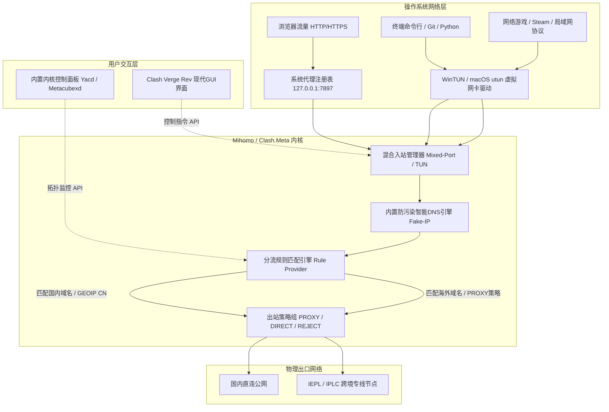
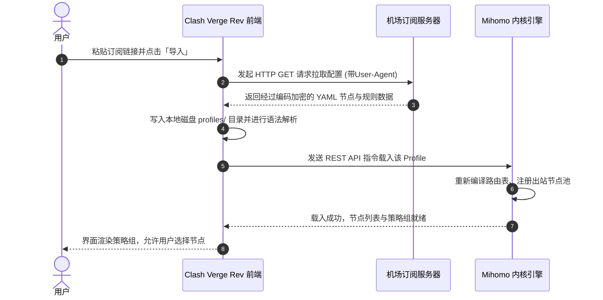
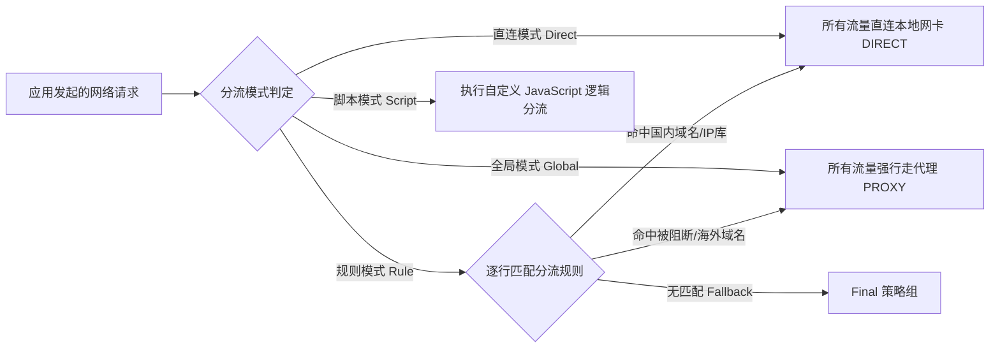
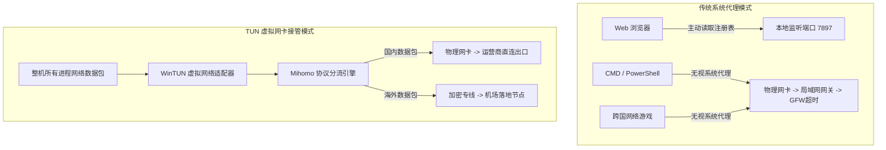
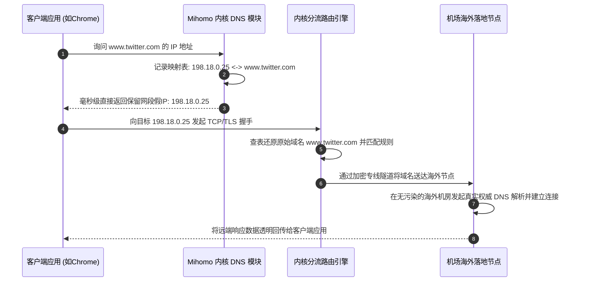
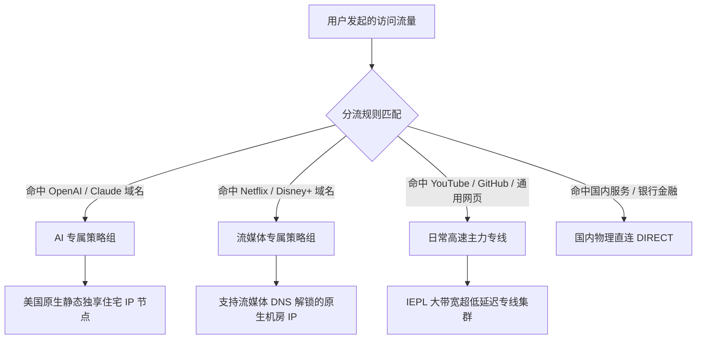
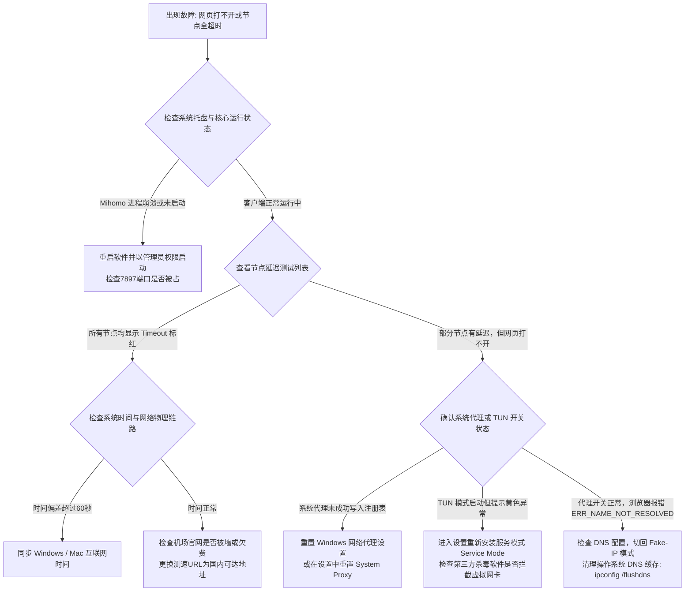

## 为什么 2026 年必须彻底升级到 Clash Verge Rev？

对于广大习惯通过桌面端进行跨境科研、海外办公、流媒体观影与代码拉取的极客及普通用户而言，选择一款安全、健壮且长期维护的本地代理客户端，是确保全流程网络畅通的关键基石。

许多用户电脑中至今依然保留着早已在 2023 年底停止维护的 **Clash for Windows (CFW)**。继续运行停更客户端正面临严峻的现实隐患：
1. **协议层技术断代**：旧版 CFW 依赖的闭源旧内核停留在历史版本，无法解析与支持现代代理协议（如采用 TLS 1.3 深度伪装的 VLESS Reality、基于 UDP 单发多收抗拥塞的 Hysteria 2、以及新一代 TUIC v5），导致许多升级了新协议的高可用机场节点在 CFW 中直接报错、无法解析或频繁断流。
2. **底层安全漏洞风险**：CFW 基于旧版 Electron 框架构建，存在已公开的远程代码执行（RCE）与本地提权风险，由于原作者已删库归档，这些安全短板永远无法得到官方补丁修复。
3. **虚拟网卡适配不良**：在 Windows 11 22H2/23H2/24H2 以及 macOS Sonoma/Sequoia 等新一代操作系统中，旧版 CFW 的 TAP 驱动频频出现路由表死锁、虚拟网卡驱动证书失效、与 WSL2 / Hyper-V 冲突导致整机断网等顽疾。

在此背景下，完全基于现代开源生态、由全球社区活跃协同共建的 **Clash Verge Rev** 迅速脱颖而出，成为 2026 年跨平台桌面代理的行业标准标杆。它不仅完全兼容原有 Clash 订阅生态，更深度集成了性能强悍的 **Mihomo (原名 Clash.Meta)** 开源内核，在图形界面交互、配置管理、规则扩展、DNS 防污染以及全系统 TUN 虚拟网卡深度接管方面实现了质的跨越。

无论你是刚刚接触科学上网的零基础新手，还是需要多设备复杂分流、终端加速与内网穿透的高阶工程师，完整掌握 Clash Verge Rev 的部署与调优技术，都将带来事半功倍的网络体验。

---

## 一、客户端架构与 Mihomo 内核工作机制解析

理解一款代理软件的底层数据流向，是进行高效配置与精准排障的前提。Clash Verge Rev 并非简单的单体应用，而是一个高度模块化的**双层解耦系统**：



### 1.1 图形界面层（Clash Verge Rev 前端）
界面层负责与最终用户进行交互，采用现代化跨平台技术构建，全面融合了 Windows 11 Fluent Design 与 macOS 系统的半透明磨砂设计美学。前端主要承担以下职能：
- **订阅配置生命周期管理**：负责远端订阅 URL 的定时拉取、本地 YAML 文件校验、语法高亮展示与合并覆盖（Merge/Script）；
- **系统环境状态调度**：管理 Windows 注册表代理键值写入、系统服务（Service Mode）安装、开机自启托盘驻留；
- **核心控制 API 通信**：通过 RESTful API 与底层运行的 Mihomo 内核进程保持长连接，实时采集节点延迟、连接日志、吞吐速率并呈现在仪表盘上。

### 1.2 核心引擎层（Mihomo / Clash.Meta 内核）
位于后台默默运行的 `mihomo.exe` 是处理全部数据包的核心大脑。它是原 Clash 协议栈的最强继承与演进者，具备以下工业级特性：
- **全协议兼容体系**：原生支持 Shadowsocks(2022)、Trojan、VMess、VLESS（含 Reality 伪装与 XTLS Vision 流控）、Hysteria 2、TUIC v5、WireGuard 等几乎所有主流翻墙与加密传输协议；
- **高性能 WinTUN 驱动绑定**：彻底抛弃了老旧且性能低下的 TAP 虚拟网卡，采用现代高性能虚拟网卡驱动，在大流量并发下载与跨国游戏低延迟传输中大幅降低 CPU 中断开销；
- **强大的规则集与脚本引擎**：支持动态 Rule-Providers 规则订阅、基于 GEOIP/GEOSITE 高速数据库的地理分流、以及通过 JavaScript/YAML Script 实施深度策略重写。

若想了解底层专线节点与中转节点的物理传输区别，可同步参阅 [2026年机场推荐与选购指南](/articles/airport-recommend-guide/) 以及 [IEPL与IPLC专线深度技术解析](/comparisons/iepl-vs-iplc-vs-bgp-explained/)。

---

## 二、全平台官方安装源甄别与多架构安全下载

由于科学上网软件的敏感性与极高的系统权限需求，安装包的安全性直接关乎个人数据安全、资产安全与系统稳定性。在互联网上搜索“Clash Verge 下载”时，搜索引擎首页往往充斥着大量冒充官方网站的钓鱼下载站或附带流氓推广插件的二次打包镜像。

> [!WARNING]
> **切勿从非受信任渠道获取安装包**
> 二次打包的代理软件极其危险，恶意第三方可能在内核或主程序中植入后门、劫持你的代理端口或盗取加密货币钱包私钥。必须且仅允许从开源官方发布页获取安装文件。

### 2.1 官方唯一发布源与版本选择
Clash Verge Rev 的官方代码托管与版本发布仓库为：
`https://github.com/clash-verge-rev/clash-verge-rev/releases`

在 Releases 页面中，面对长串的安装包文件名，不同操作系统与硬件架构的用户应严格按以下标准对号入座：

| 操作系统 | 硬件处理器架构 | 推荐下载安装包文件名 | 安装模式特点说明 |
|---------|-------------|-------------------|----------------|
| **Windows 11 / 10** | Intel / AMD 64位 (常规电脑) | `Clash.Verge_x.x.x_x64-setup.exe` | 推荐首选。具备标准安装向导，自动配置开机引导与上下文关联 |
| **Windows 11 / 10** | Intel / AMD 便携免安装版 | `Clash.Verge_x.x.x_x64_portable.zip` | 适合放置在移动硬盘或非管理员受限办公电脑，配置随文件夹携带 |
| **Windows ARM** | 骁龙 Surface / ARM64 笔记本 | `Clash.Verge_x.x.x_arm64-setup.exe` | 原生 ARM64 指令集编译，性能强劲且功耗极低，杜绝模拟翻译开销 |
| **macOS (苹果电脑)** | M1 / M2 / M3 / M4 系列 Apple Silicon | `Clash.Verge_x.x.x_aarch64.dmg` | 苹果自研芯片原生版本，无需 Rosetta 转译，内存占用极小 |
| **macOS (老款苹果)** | Intel Core 处理器 (老款 Mac) | `Clash.Verge_x.x.x_x64.dmg` | 面向 Intel 架构老旧 Mac 机型构建的兼容镜像 |
| **Linux (Ubuntu/Debian)** | x86_64 桌面发行版 | `clash-verge_x.x.x_amd64.deb` | 支持 `sudo dpkg -i` 一键安装，集成系统服务与桌面图标 |
| **Linux (通用发行版)** | 任何主流 64位 Linux 系统 | `Clash.Verge-x.x.x-x86_64.AppImage` | 免解压独立运行，赋予执行权限 `chmod +x` 后直接双击拉起 |

### 2.2 安装包完整性校验（SHA256 鉴真）
下载完毕后，推荐通过系统内置命令行工具核验文件哈希值，确保下载过程未被运营商缓存污染或第三方劫持：

在 Windows PowerShell 中执行：
```powershell
Get-FileHash -Algorithm SHA256 "C:\Users\Downloads\Clash.Verge_x.x.x_x64-setup.exe"
```

在 macOS Terminal 中执行：
```bash
shasum -a 256 ~/Downloads/Clash.Verge_x.x.x_aarch64.dmg
```

将终端打印出的 64 位十六进制哈希字符串，与 GitHub Releases 页面对应 `.sha256` 校验文件中的官方哈希值逐位比对，完全一致方可放心双击安装。

---

## 三、首次启动与系统环境初始化配置

安装完成后首次启动 Clash Verge Rev，建议按照标准化工业规范完成一系列底层环境初始化。合理的初始设置能够彻底规避后续 90% 的权限冲突与闪退异常。

### 3.1 界面语言与主题偏好
1. 首次打开软件后，若界面显示英文，点击左侧菜单栏齿轮图标 **「Settings」**；
2. 在 **「Verge Setting」** 区域找到 **「Language」** 选项，下拉切换为 **「简体中文」**；
3. 根据个人习惯选择外观主题（暗色 / 亮色 / 跟随系统）。

### 3.2 默认内核与运行模式确认
Clash Verge Rev 允许用户在不同内核间切换，但默认且强烈推荐使用的内核始终是 **Mihomo (Clash.Meta)**：
- 在设置页中核对 **「内核选择 (Core)」** 项，确保标记为 `Mihomo`；
- 切勿手动降级切换至已废弃的原版 Clash 内核，否则将失去 VLESS、Reality、Hysteria2 以及高级规则集的支持能力。

### 3.3 核心前置：安装服务模式 (Service Mode)
这是后续开启底层 TUN 虚拟网卡模式的核心前提！
- 点击设置面板中的 **「服务模式 (Service Mode)」** 右侧管理按钮；
- 在弹出的子窗口中点击 **「安装 (Install)」**；
- 此时 Windows 操作系统会弹出 UAC（用户账户控制）提权弹窗，必须点击 **「是」** 授权；
- 安装成功后，该项指示灯将变为鲜绿色，标记状态为 `已激活 (Active)`。服务模式常驻为 Windows 系统底层服务（`clash-verge-service`），使得客户端无需频繁以管理员身份重启即可安全调用网卡与路由表 API。

---

## 四、机场订阅导入与配置自动化管理全流程

客户端部署就绪后，第二步是导入高质量的机场节点订阅。本文以通过本站客观评测认证的主流品牌（如 [光速云](/brands/guangsu/) 或 [暮光加速](/brands/muguang/)）为例，详细拆解订阅导入与自动更新机制。若需横向寻找性价比卓越的平价梯队，亦可参考 [高性价比机场横向深度实测](/articles/cost-effective-airport-comparison/)。

### 4.1 获取正确格式的 Clash 订阅链接
1. 登录你的机场用户中心后台，在仪表盘页面找到 **「快捷导入」** 或 **「订阅链接」** 模块；
2. 找到 **「Clash 订阅」** 或 **「Clash.Meta 订阅」** 按钮，点击并选择 **「复制订阅地址」**；
3. 务必确保复制出的链接以 `http://` 或 `https://` 开头，且包含专属于你账户的鉴权 Token。严禁将带有完整 Token 的订阅链接发送给他人或公开在公共网络上。



### 4.2 将订阅链接添加至 Clash Verge Rev
1. 点击左侧导航栏的 **「订阅」 (Profiles)** 标签页；
2. 在顶部的输入框中，直接按下 `Ctrl + V` 粘贴刚才复制的机场订阅 URL；
3. 点击输入框右侧的 **「导入」 (Import)** 蓝色按钮；
4. 软件将自动向机场服务器发起网络请求。如果网络畅通，界面下方会立即生成一张独立的配置卡片，显示机场名称、节点总数以及更新时间；
5. 鼠标左键**单机选中**该卡片，卡片左侧或边缘会出现高亮边框，表示当前已将该配置激活为主运行配置。

### 4.3 配置自动更新与定时同步（告别节点失效）
机场服务商会定期对维护线路进行热迁移、剔除被污染 IP 或补充优质落地节点。如果长时间不更新订阅，可能会导致大量节点超时。
- 鼠标右键点击刚才导入的订阅配置卡片，在右键上下文菜单中选择 **「编辑」 (Edit)**；
- 找到 **「更新间隔 (Update Interval)」**，建议将其设置为 **`1440` 分钟（即 24 小时）** 或 **`720` 分钟（12 小时）**；
- 这样，只要电脑处于开机联网状态，Clash Verge Rev 将在后台自动静默拉取最新的可用节点，完全无需人工频繁手动点击刷新。

> [!TIP]
> **订阅拉取失败报错排查**
> 如果点击导入后软件弹出 `Network Error`、`404 Not Found` 或 `SSL Handshake Failed`：
> 1. 首先尝试开启一个临时可用的备用节点，勾选客户端的「允许在已有代理环境下更新订阅」；
> 2. 检查系统时间是否精准同步。具体更全面的订阅异常解决方案，可参考专题专著 [订阅链接无法拉取与404/500错误彻底排查](/resources/subscription-issues/)。

---

## 五、核心分流模式对比与科学选型指南

进入左侧 **「代理」 (Proxies)** 菜单，顶部会直观列出四种运行分流模式。理解这四种模式的差异，是确保国内网络流畅、海外访问畅通、流量不被过度消耗的核心所在。



### 5.1 规则模式 (Rule) —— 99% 场景的主力推荐
- **工作机制**：每一个发起的网络连接请求，都会经过内置的几千上万条规则集进行逐行过滤。访问百度、淘宝、知乎、微信等国内 IP/域名时走直连通道（完全不消耗机场流量且享受千兆内网极速）；访问 Google、YouTube、GitHub、Twitter 等海外服务时自动路由至代理节点。
- **适用人群**：日常办公、学术检索、影音娱乐等全天候挂机状态。

### 5.2 全局模式 (Global) —— 针对性排障与临时跨境
- **工作机制**：无视所有规则集，强制将电脑中发起的所有网络请求无差别送入代理服务器。
- **优劣势**：
  - *优点*：当某个生僻小众的海外网站在规则模式下打不开、漏流时，开启全局模式能强力连通；
  - *缺点*：访问国内微信、网易云音乐、Bilibili 会严重变慢，可能导致国内服务异地登录告警，且会无端耗费宝贵的机场专线流量。

### 5.3 直连模式 (Direct) —— 纯内网免代理
- **工作机制**：完全停用出站代理，相当于将代理软件作为纯透明旁路，所有请求走本地原始物理网关。
- **适用场景**：暂时不需要代理或怀疑客户端导致局域网打印机连接异常时的对比排查。

### 5.4 脚本模式 (Script) —— 极客深度定制
- 支持用户使用 ECMAScript 编写动态逻辑，例如根据请求发生的时间、工作日状态或客户端进程名精准分派至不同的落地节点。

---

## 六、进阶实战：TUN 虚拟网卡模式全系统接管

对于进阶极客、开发者与海外游戏玩家而言，**系统代理（System Proxy）** 机制存在天然的“致命短板”：
- 很多跨国客户端（如 Git 命令行、Python pip、Docker 守护进程、Telegram 桌面版、Spotify、Steam 商店以及各类吃鸡/竞技跨国网游）**完全不遵循操作系统的系统代理注册表设置**；
- 即便你在 Clash Verge Rev 中开启了系统代理，CMD 终端里运行 `git clone` 或 `ping google.com` 依然会显示网络超时。

彻底攻克这一难题的终极方案，便是开启 **TUN (Tunnel) 虚拟网卡模式**！

### 6.1 TUN 模式底层工作拓扑
TUN 模式会在 Windows/macOS 系统内部虚拟出一张名为 `Mihomo` 或 `WinTun` 的软件网卡，并将整机默认路由跃点数（Metric）进行调整，使得操作系统网络栈的所有底层原始 IP 数据包无差别进入该虚拟网卡，交由 Mihomo 内核进行逐包深度检测和规则分流：



### 6.2 开启 TUN 模式标准操作四步法
1. **确认服务模式就绪**：按照本文第三节指引，确保「设置」->「服务模式」已成功安装且处于绿色激活状态；
2. **启用 TUN 模式主开关**：在左侧「设置」页面中，找到 **「TUN 模式 (TUN Mode)」**，直接将开关滑块拨动至右侧开启状态；
3. **确认虚拟网卡加载**：
   - 在 Windows 系统中按下 `Win + R` 键，输入 `ncpa.cpl` 回车打开网络连接面板；
   - 检查网络适配器列表中是否新增了一张名为 `Mihomo`（或描述为 `Wintun Userspace Tunnel`）的网络连接，并显示“已启用”；
4. **验证全系统接管效果**：
   - 打开 Windows PowerShell，无需任何代理环境变量，直接执行：
     ```powershell
     curl.exe -I https://www.google.com
     ```
   - 如果控制台立即返回 `HTTP/2 200` 或 `HTTP/1.1 200 OK`，说明哪怕没有配置终端代理，命令行流量已经被底层 TUN 虚拟网卡完美接管！

### 6.3 TUN 模式高级配置参数推荐
在订阅或全局扩展配置中，Mihomo 对 TUN 的标准优化参数推荐如下：

```yaml
tun:
  enable: true
  stack: mixed # 推荐 mixed 模式，兼顾 gVisor 的高兼容性与 System 栈的高并发性能
  dns-hijack:
    - "tcp://any:53"
    - "udp://any:53"
  auto-route: true # 自动配置操作系统路由表
  auto-redirect: false
  auto-detect-interface: true # 自动检测主物理网卡，防止多网卡环境路由死锁
```

若在配置过程中遇到网络环路、端口占用或适配器黄色感叹号问题，请同步参考针对性专著 [Clash故障排查与DNS调优指南](/clash/troubleshooting/)。

---

## 七、进阶 DNS 配置与防污染抗劫持深度调优

DNS（域名解析系统）是跨境网络中最容易被忽视、却对速度和稳定性起决定性作用的环节。国内运营商长久以来部署了严密的 DNS 投毒与劫持策略，若 DNS 处理不当，即便利节点速度再快，也会因域名被解析至错误甚至黑洞 IP 而导致网页打不开。

### 7.1 Fake-IP 模式解析机制与工作流
Mihomo 内核原生推荐并默认采用 **Fake-IP (模拟 IP 池)** 机制。该机制的工作逻辑堪称优雅与高效的典范：



**Fake-IP 的核心优势**：
1. **零解析等待延迟**：本地应用发起解析时，内核不需要等待远端跨洋 DNS 返回，耗时仅 0.5 毫秒即可返回 Fake-IP，极大提升网页打开的首屏渲染感知；
2. **彻底免疫本地运营商投毒**：本地根本不对海外域名进行真实公网查询，GFW 的 DNS 投毒无从施展；
3. **真实解析在落地端完成**：由于海外节点在当地发起真实解析，自动匹配最近的海外 CDN 边缘节点，保障 YouTube、Netflix 获得最高画质带宽。

### 7.2 生产级 DNS 配置推荐（可放入订阅扩展或 Merge 配置中）
```yaml
dns:
  enable: true
  listen: 0.0.0.0:1053
  ipv6: false # 若家庭宽带无原生IPv6，建议关闭以防IPv6解析超时回退
  default-nameserver:
    - 223.5.5.5
    - 119.29.29.29
  enhanced-mode: fake-ip
  fake-ip-range: 198.18.0.1/16
  use-hosts: true
  nameserver:
    - https://doh.pub/dns-query
    - https://dns.alidns.com/dns-query
  fallback:
    - https://1.1.1.1/dns-query
    - https://8.8.8.8/dns-query
  fallback-filter:
    geoip: true
    geoip-code: CN
    ipcidr:
      - 240.0.0.0/4
```

---

## 八、规则集 (Rule-Providers) 与订阅扩展配置深度定制

掌握了基础操作后，高级用户可以通过编写规则扩展（Merge / Script），赋予 Clash Verge Rev 强大的定制能力，例如实现针对 **OpenAI ChatGPT、Claude、国内金融网银、局域网 NAS** 的精准分流。

### 8.1 什么是 Rule-Providers？
传统配置中，规则是以纯文本形式硬编码在单一 YAML 文件中，动辄数千行，既臃肿又无法自动更新。Mihomo 内核引入了 **Rule-Providers（规则集提供者）** 概念：它允许客户端从远端 GitHub 或 CDN 动态订阅由专业开源团队维护的分流规则库，在后台定时自动增量拉取。

### 8.2 典型生产级 Rule-Providers 配置片段
在 Clash Verge Rev 中点击「订阅」-> 找到你的配置右击选择「编辑扩展配置」或在「配置合并」中插入：

```yaml
rule-providers:
  # 专门针对 OpenAI / ChatGPT / Claude / Gemini 的精准规则集
  ai-services:
    type: http
    behavior: classical
    url: "https://raw.githubusercontent.com/blackmatrix7/ios_rule_script/master/rule/Clash/OpenAI/OpenAI.yaml"
    path: ./ruleset/ai-services.yaml
    interval: 86400

  # 国内主流直连域名清单
  china-direct:
    type: http
    behavior: domain
    url: "https://raw.githubusercontent.com/Loyalsoldier/clash-rules/release/direct.txt"
    path: ./ruleset/china-direct.yaml
    interval: 86400

rules:
  # 优先将 AI 服务路由至原生纯净落地节点
  - RULE-SET,ai-services,AI专属策略组
  # 国内直连规则
  - RULE-SET,china-direct,DIRECT
  - GEOIP,CN,DIRECT
  # 其余海外未知流量走主代理
  - MATCH,节点选择
```

通过将 AI 服务绑定到特定的「AI专属策略组」，你可以将 ChatGPT 固定走美国或日本原生住宅 IP 节点，避免频繁切换节点触发 OpenAI 的风控封禁机制。欲了解哪些机场提供优质的解锁节点，可参考 [31家机场参数与流媒体解锁数据库](/brands/)。

---

## 九、跨操作系统平台深度适配技巧与权限避坑

不同操作系统的安全机制与网络虚拟化架构存在巨大差异，针对 Windows、macOS 与 Linux 的特性进行精准适配，能够彻底解决“特定系统打不开特定软件”的顽疾。

### 9.1 Windows 11/10：UWP 应用本地回环隔离豁免 (Loopback Exemption)
在 Windows 平台中，很多用户开启代理后发现：Edge 浏览器、Chrome 能够流畅访问海外网站，但 Windows 自带的 **Microsoft Store 应用商店、Xbox 游戏登录、OneNote、OneDrive、Windows Terminal 插件** 频繁弹出无法联网错误代码（如 `0x80072EFD`）。

- **根本原因**：Windows 现代 UWP 架构为了安全隔离沙箱权限，默认禁止所有通用 Windows 平台应用访问本地回环网络（`127.0.0.1` / `localhost`）。因此，当系统代理指向 `127.0.0.1:7897` 时，UWP 应用发出的数据包被操作系统防火墙在本地回环口强制阻断。
- **解决方案**：
  1. 打开 Clash Verge Rev 设置，在工具栏中点击 **「UWP 应用免代理工具 (EnableLoopback Utility)」**；
  2. 软件会弹出一个列出本机所有已安装 UWP 应用的列表窗口；
  3. 点击顶部的 **「Exempt All (全部豁免)」**，然后点击 **「Save Changes (保存修改)」**；
  4. 或者在管理员身份运行的 CMD 中执行官方隔离豁免命令：
     ```cmd
     CheckNetIsolation.exe LoopbackExempt -a -p=S-1-15-2-1
     ```
  5. 豁免生效后，微软应用商店与 Xbox 即刻顺畅穿透代理恢复正常通信。

### 9.2 macOS (Sonoma / Sequoia)：Gatekeeper 拦截与权限绕过
在 macOS 苹果电脑上，尤其是搭载 M1/M2/M3/M4 Apple Silicon 芯片的设备，首次安装或开启 TUN 模式常遇两大拦路虎：

- **问题一：提示“应用程序已损坏，无法打开”**：
  - *原因*：macOS 新版安全机制对未向 Apple 支付高额公证费用的开源软件进行强行拦截。
  - *终端解决方案*：打开 macOS 终端 (Terminal)，执行以下属性清除命令：
    ```bash
    sudo xattr -r -d com.apple.quarantine /Applications/Clash\ Verge.app
    ```
    输入开机密码回车后，即可正常双击启动软件。
- **问题二：TUN 模式提示 Helper 辅助程序权限缺失**：
  - 打开 macOS「系统设置」->「隐私与安全性」->「全盘访问权限」；
  - 勾选 `clash-verge` 与 `mihomo`，赋予辅助守护进程对虚拟网络接口 `utun` 的创建与注销权限。

### 9.3 Linux 发行版：Headless 无图形界面服务器守护进程托管
在生产级 Ubuntu Server、Debian 或家庭软路由 Linux 环境中，常常需要在没有 X11/Wayland 桌面环境的纯命令行下托管 Mihomo 引擎：

创建 systemd 服务文件 `/etc/systemd/system/mihomo.service`：
```ini
[Unit]
Description=Mihomo (Clash.Meta) Daemon Service
After=network.target network-online.target
Wants=network-online.target

[Service]
Type=simple
User=root
ExecStart=/usr/local/bin/mihomo -d /etc/mihomo
Restart=on-failure
RestartSec=5
LimitNOFILE=65535

[Install]
WantedBy=multi-user.target
```

启动并设置开机自动守护：
```bash
sudo systemctl daemon-reload
sudo systemctl enable --now mihomo
sudo systemctl status mihomo
```

配合 WebUI 外部控制器（例如在内网通过 `http://192.168.1.x:9090/ui` 打开 Yacd 控制面板），即可在 Linux 服务器端享受工业级的智能分流与局域网网关转发能力。

---

## 十、极客进阶：配置合并 (Merge) 与 JavaScript 自动化脚本清洗

经常使用多份机场订阅的资深极客，最头疼的问题往往是：不同机场命名的节点名称极度混乱（例如带有复杂的广告推销网址、各种表情符号 emoji、或是不同倍率混杂在一起）。如果直接导入使用，会严重污染策略组界面。

Clash Verge Rev 支持基于 **JavaScript 运行时的配置脚本重写机制 (Script)**，能在订阅每次拉取写入磁盘前，在内存中动态完成数据清洗、去广告、倍率重算与策略组重组！

### 10.1 典型生产级 JavaScript 订阅扩展清洗脚本
在 Clash Verge Rev 中点击「订阅」->「新建」-> 类型选择「Script」，输入以下代码：

```javascript
/**
 * Clash Verge Rev 生产级订阅自动化清洗与策略组重构脚本
 * @param {Object} config - 原始订阅解析生成的配置对象
 * @returns {Object} 经过清洗增强后的最终生产配置
 */
function main(config) {
  // 1. 提取所有有效节点
  const proxies = config.proxies || [];
  
  // 2. 节点过滤：剔除官网公告、流量提示、返利推广等无效假节点
  const validProxies = proxies.filter(p => {
    const name = p.name;
    const isAd = /官网|通知|剩余|过期|重置|群|TG|防失联|广告|推广/i.test(name);
    return !isAd;
  });

  // 3. 节点重命名与标签标准化：提取国家地区并规范化
  validProxies.forEach(p => {
    if (/香港|HK|Hong Kong/i.test(p.name)) p.name = `🇭🇰 香港 | ${p.name.replace(/.*?(香港|HK).*?/i, '').trim() || '专线'}`;
    else if (/日本|JP|Japan|东京|大阪/i.test(p.name)) p.name = `🇯🇵 日本 | ${p.name.replace(/.*?(日本|JP).*?/i, '').trim() || '专线'}`;
    else if (/台湾|TW|Taiwan|台北/i.test(p.name)) p.name = `🇨🇳 台湾 | ${p.name.replace(/.*?(台湾|TW).*?/i, '').trim() || '专线'}`;
    else if (/新加坡|SG|Singapore|狮城/i.test(p.name)) p.name = `🇸🇬 新加坡 | ${p.name.replace(/.*?(新加坡|SG).*?/i, '').trim() || '专线'}`;
    else if (/美国|US|America|洛杉矶|硅谷/i.test(p.name)) p.name = `🇺🇸 美国 | ${p.name.replace(/.*?(美国|US).*?/i, '').trim() || '专线'}`;
  });

  config.proxies = validProxies;

  // 4. 重建专业策略组结构
  const proxyNames = validProxies.map(p => p.name);
  const hkNames = validProxies.filter(p => p.name.includes('香港')).map(p => p.name);
  const jpNames = validProxies.filter(p => p.name.includes('日本')).map(p => p.name);
  const usNames = validProxies.filter(p => p.name.includes('美国')).map(p => p.name);

  config['proxy-groups'] = [
    {
      name: '🚀 节点选择',
      type: 'select',
      proxies: ['♻️ 自动优选', '🇭🇰 香港中继', '🇯🇵 日本中继', '🇺🇸 美国中继', ...proxyNames]
    },
    {
      name: '♻️ 自动优选',
      type: 'url-test',
      url: 'http://cp.cloudflare.com/generate_204',
      interval: 300,
      tolerance: 50,
      proxies: proxyNames
    },
    {
      name: '🤖 AI 大模型',
      type: 'select',
      proxies: ['🇺🇸 美国中继', '🇯🇵 日本中继', '🚀 节点选择']
    },
    {
      name: '🎬 流媒体服务',
      type: 'select',
      proxies: ['🇭🇰 香港中继', '🇯🇵 日本中继', '🚀 节点选择']
    },
    {
      name: '🇭🇰 香港中继',
      type: 'url-test',
      url: 'http://cp.cloudflare.com/generate_204',
      interval: 300,
      proxies: hkNames.length > 0 ? hkNames : ['DIRECT']
    },
    {
      name: '🇯🇵 日本中继',
      type: 'url-test',
      url: 'http://cp.cloudflare.com/generate_204',
      interval: 300,
      proxies: jpNames.length > 0 ? jpNames : ['DIRECT']
    },
    {
      name: '🇺🇸 美国中继',
      type: 'url-test',
      url: 'http://cp.cloudflare.com/generate_204',
      interval: 300,
      proxies: usNames.length > 0 ? usNames : ['DIRECT']
    }
  ];

  return config;
}
```

将该脚本保存后，绑定至你的订阅卡片。未来每次订阅刷新，软件均会自动执行该脚本，为你输出整齐划一、纯净无广告、且分类明确的极客专属控制面板！

---

## 十一、跨国游戏加速与 UDP Full-Cone NAT 深度调优实战

对于 Steam、Epic、PlayStation、Nintendo Switch 及各类跨国多人联机竞技游戏（如《Apex 英雄》、《CS2》、《使命召唤》、《战地》）玩家而言，代理工具不仅要保证 TCP 带宽，更对 **UDP 传输质量与 NAT 类型** 提出了极其苛刻的要求。

### 11.1 为什么普通系统代理无法用于联机游戏？
绝大多数竞技网络游戏采用基于 **UDP 协议** 的数据帧进行玩家位置同步、弹道计算与语音即时传输（VoIP）。
- 普通的「系统代理」仅工作在 TCP 应用层，完全无法接管 UDP 数据包；
- 开启 TUN 模式虽然能将 UDP 包送入代理隧道，但如果代理节点的 NAT 类型受限（如 Symmetric 对称型 NAT），会导致玩家在游戏中出现 **NAT 3 / Strict 严苛型** 告警，引发无法加入派对、语音开麦断断续续、甚至搜索不到对局房间的绝望体验。

### 11.2 Full-Cone NAT (全锥型 NAT) 工作原理与配置
为了实现游戏主机与 PC 竞技的 **NAT 1 / Open 开放型** 体验，底层节点必须支持 Full-Cone NAT。在 Clash Verge Rev 中，需在全局配置中确保开启以下内核级参数：

```yaml
# 开启 UDP 支持与高性能全锥型 NAT 映射
udp: true

# 开启 TCP 并发与底层 Socket 缓冲区优化
tcp-concurrent: true

# TUN 模式针对 UDP 游戏优化
tun:
  enable: true
  stack: mixed
  # 关键参数：开启端点独立映射 (Endpoint-Independent Mapping)
  endpoint-independent-mapping: true
```

此外，选择游戏节点时，务必挑选采用 **IEPL 企业内网专线** 的直达节点（如 [光速云](/brands/guangsu/) 的游戏定制专线）。专线不仅物理抖动小于 2ms，更不经过公网 NAT 层层转换，能够将丢包率牢牢锁定在 0.1% 以下，彻底杜绝团战瞬移与掉线惩罚。

---

## 十二、4K 流媒体与 AI 大模型（ChatGPT / Claude）落地纯净度与独立分流

进入 2026 年，以 **OpenAI ChatGPT、Anthropic Claude、Google Gemini、Netflix、Disney+** 为代表的海外顶级数字服务平台，对访问者 IP 的“纯净度”审查达到了空前严格的水平。

### 12.1 常见的流媒体与 AI 风控报错代码剖析
- **ChatGPT 报错 `Access Denied (1020)` 或 `Unable to load site`**：表明你当前使用的落地节点 IP 被 Cloudflare 或 OpenAI 威胁情报库标记为机房公用代理，信誉分过低直接拒绝握手；
- **Claude 报错 `Your account has been disabled` 或直接拒绝发送消息**：Claude 对 IP 归属地与欺诈风控模型极度敏感，严禁频繁在香港、台湾与美国节点之间秒级漂移跳跃；
- **Netflix 仅能观看自制剧（Netflix Originals），无法搜索本地授权影视剧**：证明该节点 IP 已被 Netflix 版权库列入黑名单，实行了软性封锁（DNS 降级处理）。

### 12.2 生产级独立分流拓扑实现方案
解决上述痛点的唯一根本途径，是实行**“动静分离、专线专用”**的独立分流策略：



通过在 Clash Verge Rev 中配置独立的策略组，让 AI 服务固定走美国信誉极高的纯净住宅 IP，日常看 4K 视频走大带宽的香港/新加坡 IEPL 专线，国内网银购物走本地直连，互不干扰，彻底根治封号与降权隐患。

---

## 十三、全系统故障排查决策树与高频异常处置

即便在最稳定的网络环境中，由于操作系统更新、休眠唤醒、端口占用或第三方防火墙干扰，偶尔也会遇到网络连接阻断。以下整理出业界最完备的故障诊断流程树：



### 13.1 故障一：无法拉取订阅，提示 `Fetch failed` 或 `certificate has expired`
- **成因剖析**：由于首次配置时电脑尚未翻墙，而部分机场的订阅域名位于海外或启用了 Cloudflare CDN 防护，在受到本地运营商干扰时无法直连拉取；或是本机时间错误导致 SSL 证书验证失败。
- **解决方案**：
  1. 按 `Win + R` 输入 `timedate.cpl` 打开日期与时间设置，点击「Internet 时间」->「更改设置」-> 点击「立即更新」同步授时；
  2. 若仍无法拉取，登录机场后台下载离线 `.yaml` 配置文件，在 Clash Verge Rev 中点击「从文件导入 (Import from file)」，导入成功并开启代理后，即可恢复在线自动更新功能。

### 13.2 故障二：Windows 端口占用导致内核启动失败 (`listen tcp 127.0.0.1:7897: bind: address already in use`)
- **成因剖析**：先前的代理软件（如老版 CFW、v2rayN、Fiddler 等）未正常退出，或 Clash Verge Rev 上次异常退出时内核进程残留在后台。
- **排查命令**：
  在 Windows CMD 中查询占用 7897 端口的进程 PID：
  ```cmd
  netstat -ano | findstr 7897
  ```
  假设查出占用进程的 PID 为 `14520`，强制结束该进程：
  ```cmd
  taskkill /F /PID 14520
  ```
  随后在 Clash Verge Rev 界面点击「重新启动内核」即可顺畅运行。

### 13.3 故障三：TUN 模式开启后整机断网，连国内百度也无法访问
- **成因剖析**：通常是虚拟网卡路由优先级高于物理网卡，但 Mihomo 内核在建立 TUN 监听时因第三方安全防护软件（如 360 安全卫士、火绒网络防护、火绒虚拟网卡保护）拦截，导致数据包进入虚拟网卡后无法转发给物理网卡，形成网络黑洞。
- **解决方案**：
  1. 临时关闭 TUN 开关，网络立即恢复正常；
  2. 将 `clash-verge.exe` 及 `mihomo.exe` 完整目录加入第三方安全防护软件的“信任白名单”；
  3. 检查电脑中是否存在其他 VPN 或虚拟网卡软件（如 TAP-Windows、OpenVPN、蒲公英等），进入设备管理器将冲突的多余虚拟网卡禁用；
  4. 重新安装 Clash Verge 的服务模式。

---

## 十四、长期运行维护、开机守护与性能优化策略

对于需要将客户端长期驻留后台的用户，科学的维护配置能够保障客户端数月不重启依然保持轻快、低内存占用与高可用性。

### 14.1 开机自启动与静默守护
在 Clash Verge Rev 的设置面板中，推荐开启以下组合开关：
- **开机自启 (Launch at Login)**：开启。保证电脑重启开机登录后自动拉起；
- **静默启动 (Silent Start)**：开启。开机时不弹出庞大的主窗口打扰视线，仅静默缩小至系统托盘；
- **关闭窗口退出程序**：建议关闭。点击右上角关闭按钮时，仅仅将窗口最小化至托盘，防止手滑误关导致正在进行的跨国会议或下载任务中断。

### 14.2 内存占用控制与日志维护
长期运行下，如果开启了 DEBUG 级别的实时连接日志，内存与磁盘日志文件会逐渐膨胀：
- 在「设置」中将 **「日志等级 (Log Level)」** 调整为 `warning` 或 `error`，避免记录繁杂的日常连接流，大幅减轻日志写入开销；
- 定期进入软件配置目录，清理历史缓存文件。

### 14.3 局域网共享代理 (Allow LAN) 与多设备协同加速
如果你在家庭或小型办公室局域网中，有 Nintendo Switch、PS5 游戏主机或备用测试手机不便直接安装代理客户端，可以利用 Clash Verge Rev 的局域网中继功能：
1. 在设置中开启 **「允许局域网连接 (Allow LAN)」** 开关；
2. 记下电脑在家庭路由器内分配的私有 IPv4 地址（如 `192.168.1.188`）以及软件混合端口（默认 `7897`）；
3. 打开手机或游戏主机的 Wi-Fi 高级设置，将 HTTP 代理设置为「手动」，主机名填写电脑 IP `192.168.1.188`，端口填写 `7897`；
4. 此时，游戏主机与移动设备的所有流量均将自动借由电脑端的 Clash Verge Rev 实现透明加速分流，无需每台设备重复导入订阅。

---

## 十五、站内内容关系与内部链接导航

本篇专著作为网站 **Clash 客户端核心专题** 的重要实操支柱，与全站其他专题及相关评测形成了严密的网状知识闭环：

### 1. 向上汇聚链接（核心专题门户）
- 返回客户端一级大本营：[Clash 客户端核心专题矩阵](/clash/)，查阅全生态客户端演进历程与架构对比；
- 了解全系横向横评：[全平台 Clash 客户端深度推荐与横向对比](/clash/recommend/)。

### 2. 横向延伸链接（同级兄弟专题与排障实战）
- 官方安装包深度鉴真：[Clash Verge Rev 官方安装包下载与版本选择指南](/clash/verge-download/)；
- 订阅链接高级管理：[Clash Verge 订阅导入与自动化规则管理](/clash/verge-subscription/)；
- 深入探索内核新特性：[Mihomo (Clash.Meta) 内核进阶特性与配置指南](/clash/meta/)；
- 遇到复杂网络异常时的排障手册：[Clash 疑难杂症排查与 DNS 深度调优](/clash/troubleshooting/)；
- 移动端互补工具配置：[iOS 平台 Shadowrocket 苹果小火箭从入门到精通教程](/guides/shadowrocket-ios-setup-tutorial/)。

### 3. 向下实体链接（底层基础设施与品牌落地）
- 获取低延迟、高带宽的 IEPL/IPLC 真实测速节点：[光速云客观实测评测报告](/brands/guangsu/)；
- 对比更多优质平民机场：[高性价比机场横向深度实测与盘点](/articles/cost-effective-airport-comparison/)；
- 查阅全网 31 家机场价格与网络架构数据：[31家主流机场品牌客观数据库中心](/brands/)。
