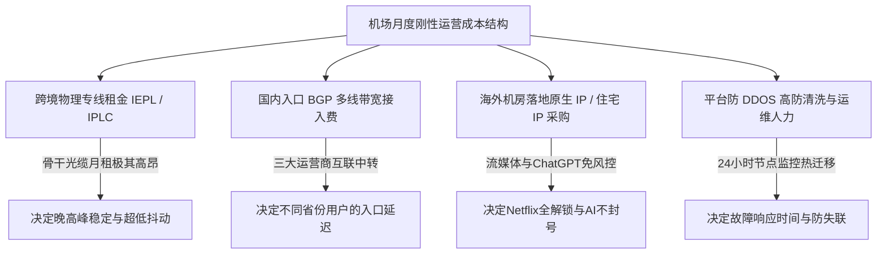
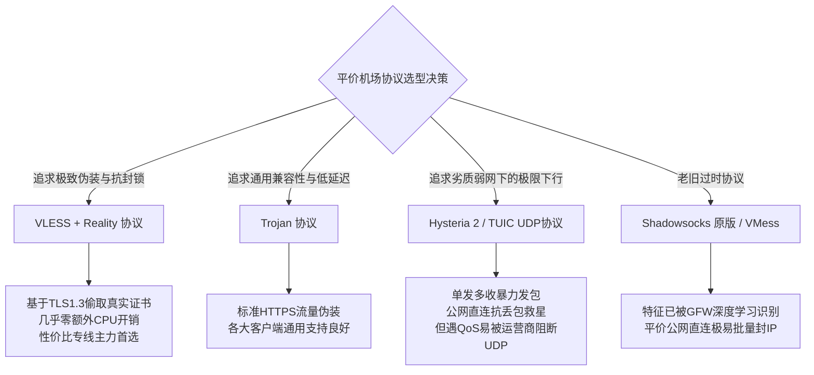
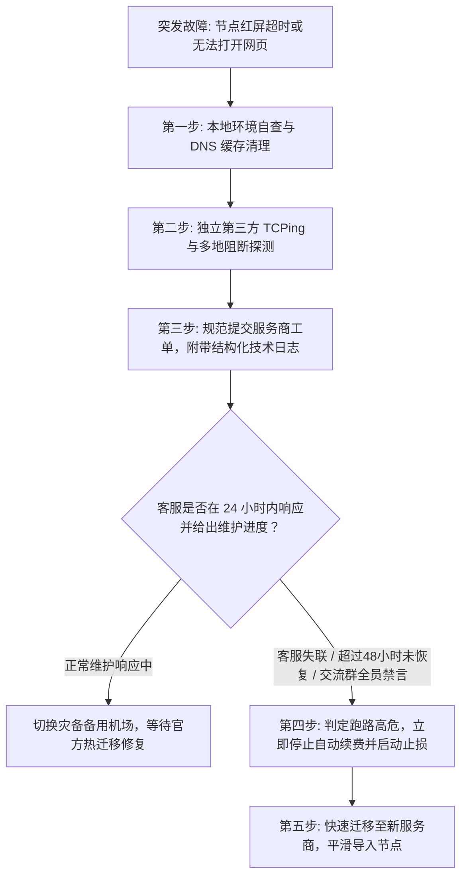
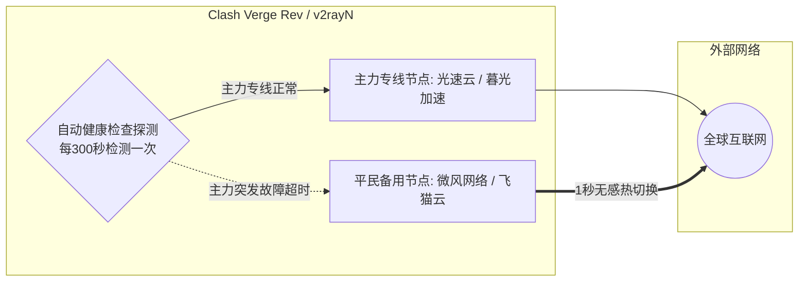

## 核心评测：什么是真正的「高性价比」？

在跨境网络与科学上网消费领域，「高性价比」常常被不良商家偷换概念为单纯的「绝对低价」。

然而，一个必须认清的残酷现实是：**廉价不等于性价比**。如果一个机场套餐每个月看似只需要 3 元或 5 元，但一到晚上 8 点至 11 点的晚高峰时段，网页打开需要转圈 20 秒、视频只能降级到 360P 甚至频繁断流报错，更在关键的海外工作会议、ChatGPT 长文本交互或代码推送时直接失联——那么这 3 元钱不仅没有产生任何价值，反而造成了时间与情绪的巨大浪费。

在本站测评实验室的标准化评测体系中，**真正的「高性价比」定义为：在确保全天候晚高峰无感秒开 1080P/4K 流媒体、主流 AI 工具（ChatGPT/Claude）稳定解锁且物理丢包率低于 1% 的底线前提下，用户所能获得的最低实际月均持有成本与每 GB 单价的最优平衡**。

本文基于对全网主流 31 家机场品牌的持续长效测速数据，彻底揭开从 5 元平民档到 25 元均衡档的真实成本模型，拆解各种隐形消费陷阱，为你提供一份真正经得起推测的高性价比选购指南。

---

## 一、机场运营成本大揭秘：低价的底层物理极限在哪里？

要识破虚假宣传，首先必须了解一家合规运营的代理服务商每个月到底要承担哪些刚性物理支出。没有任何商业机构会长期亏本做慈善，价格一旦击穿物理成本底线，背后必然伴随着偷工减料、严重超售或蓄意卷款跑路。



### 1.1 跨境专线带宽与公网中转的成本悬殊
- **IEPL / IPLC 企业内网专线**：由电信、联通或第三方持有牌照的跨国电信运营商提供的点对点物理光纤传输通道。流量完全在内网流动，根本不经过公网 GFW 防火长城。这种企业级专线的每 Mbps 带宽月采购成本高达几十元人民币。正因如此，纯专线机场如果敢卖“5元包月1000G”，从数学模型上是 100% 亏损的，必然在后台限制了实际可用流量或采取了高达 5-10 倍的隐形倍率。
- **公网中转与普通隧道**：通过国内大带宽云主机（如阿里云、腾讯云轻量机房）作为入口，通过加密隧道转发至海外 VPS。其带宽成本仅为专线的五分之一，平峰期表现尚可，但在晚高峰公网骨干网拥堵时，极易受到运营商 QoS 降级限速。
- **公网直连（廉价梯子）**：用户设备直接向海外廉价机房发包，零国内入口成本。这种方案每 GB 流量成本不到 2 分钱，但也是被 GFW 精准识别和批量封锁的重灾区。

### 1.2 落地 IP 质量与流媒体解锁成本
仅仅线路通畅还不够，Netflix、Disney+、OpenAI 对机房 IP 实施了严密的黑名单机制。为了保障节点能顺畅解锁 4K 流媒体与 ChatGPT，机场必须定期向海外机房采购纯净的原生 IP 段，甚至租赁成本昂贵的住宅 IP（Residential IP）配合 DNS 解锁服务器。这部分“IP 维护费”是很多 5 元以下劣质机场根本无力承担的，因此廉价机场几乎普遍无法正常使用 Claude 或观看非自制剧。

想要深入理解专线与中转在传输协议层面的差异，可参考专题专著 [IEPL与IPLC专线深度技术解析](/comparisons/iepl-vs-iplc-vs-bgp-explained/)。

---

## 二、全网 31 家机场价格带四象限分布模型

基于本站 [31家主流机场品牌客观数据库中心](/brands/) 的实测价格与线路分布，当前中文网络代理市场呈现清晰的四阶梯价格带格局：

```mermaid
quadrantChart
    title 2026年机场市场价格与服务质量四象限矩阵
    x-axis 极低月度持有成本 (¥5) --> 较高月度持有成本 (¥35+)
    y-axis 低可用性 / 易断流 --> 高可用性 / 极速抗晚高峰
    quadrant-1 豪华企业专线 (商务独享 / 极客高配)
    quadrant-2 高性价比黄金区间 (平民专线 / 优质BGP)
    quadrant-3 劣质超售陷阱 (公网直连 / 跑路高危)
    quadrant-4 溢价过高品牌 (低性能高价格)
    "飞猫云学生版 (¥7)": [0.18, 0.72]
    "光速云轻量版 (¥8)": [0.22, 0.88]
    "微风网络 (¥7)": [0.19, 0.75]
    "暮光加速标准版 (¥20)": [0.45, 0.92]
    "二猫云 (¥20)": [0.44, 0.85]
    "大佬云 (¥12)": [0.32, 0.78]
    "神行加速 (¥14)": [0.36, 0.80]
    "一元机场/超低价直连": [0.08, 0.25]
    "部分高溢价传统商用VPN": [0.82, 0.40]
```

### 2.1 第一区间：¥5 以下超平民档 —— 仅作备用，切勿作主力
- **代表生态**：各类一元机场、公网直连小作坊；
- **真实面貌**：无专线、无 SLA 服务等级保证，超售比例通常高达 1:100 以上。晚高峰延迟普遍飙升至 300ms 以上，丢包率经常突破 30%。
- **定位定位**：适合预算极度拮据、仅在白天查阅极少量网页文字、或作为防失联紧急备用梯子。

### 2.2 第二区间：¥7 - ¥15 轻量专线黄金性价比区间 —— 绝大多数个人首选
- **代表品牌**：[飞猫云](/brands/feimao/)、[光速云轻量版](/brands/guangsu/)、[微风网络](/brands/weifeng/)、[大佬云](/brands/dalaoyun/)；
- **真实面貌**：引入了真正的 IEPL 企业专线或 BGP 优质中转底座。为了压低售价，商家将每月流量控制在 50GB - 100GB，或对单连接带宽实施合理限制（如 50Mbps - 100Mbps）。
- **实测表现**：晚高峰零丢包、低延迟、可流畅秒开 YouTube 4K 与顺畅对话 ChatGPT。以极低的月消费换取了商业级专线的抗干扰能力，是学生党、普通白领、学术科研人群的绝对首选。

### 2.3 第三区间：¥18 - ¥30 中高阶专线均衡档 —— 4K/8K 影视与多设备主力
- **代表品牌**：[暮光加速](/brands/muguang/)、[二猫云](/brands/ermao/)、[SOGO云](/brands/sogo/)；
- **真实面貌**：月流量通常在 150GB - 500GB 以上，节点完全覆盖亚太、欧美主流流媒体原生机房，不限速或单节点支持高达 1Gbps - 2.5Gbps 带宽突发，支持 3-5 台设备并发在线。
- **实测表现**：重度生产力用户全天候主力，流媒体 4K 拖拽进度条无感加载，外贸团队多人协同首选。

### 2.4 第四区间：¥35 以上高阶独享档 —— 跨境商务与游戏发烧友
- **真实面貌**：提供独享原生住宅 IP、跨国竞技游戏极低抖动内网专线。

---

## 三、警惕四大「伪性价比」消费套路

在选购平价机场时，新手极易被商家花哨的宣传词蒙蔽双眼。以下拆解四大最常见的商业套路：

### 3.1 套路一：真假月付话术（文字游戏）
许多服务商在宣传海报上打出“每月仅需 5 元！全网最低！”，然而当你注册账户进入结账收银台时才发现：
- 根本没有单月购买选项，系统默认强制勾选“年付 ¥60 起”；
- 或者单月购买价格为 ¥18，只有一次性购买 2 年甚至 3 年，折算下来的月均价才是 ¥5。
- **防坑准则**：在未实际验证晚高峰网络质量前，**坚决不碰年付**！宁可首月多花两三元钱购买纯月付测试，确认连续一周晚高峰稳定后再考虑续费长周期。关于如何防范跑路风险，可深度阅读专著 [机场跑路预警与年付防坑指南](/resources/warning/)。

### 3.2 套路二：节点倍率（Multiplier）暗扣大坑
“10元 500GB 专线大流量”看起来诱人无比？请务必打开客户端查看其节点列表后的括号标注：
- 那些看似延迟极低的香港、日本 IEPL 专线，后面悄悄标注着 `(3.0x)` 甚至 `(5.0x)`；
- 只有那些位于阿根廷、土耳其、速度奇慢且经常超时的垃圾直连节点，才是 `(1.0x)`。
- **数学算式**：
  $$\text{实际可用专线流量} = \frac{\text{标称流量 } 500\text{GB}}{\text{专线倍率 } 5.0} = 100\text{GB}$$
  所谓的 500GB 瞬间缩水 80%！这种隐形扣量比直接标明 100GB 套餐更为恶劣。

### 3.3 套路三：虚假 SLA 承诺与幽灵客服
廉价小作坊通常声称“99.99% 专线可用率”，但一旦遇到主干光缆检修或线路被封锁：
- 官方 Telegram 群立即开启禁言；
- 提交的售后工单连续数天甚至数周无人回复；
- 甚至几天后直接更换域名换皮重生，原有套餐全部清零。

### 3.4 套路四：永久有效 / 不限时大流量套现
部分商家推出“¥99 购买 1000GB 永久有效不限时”套餐。
- 机场是一门重度依赖现金流续约服务器的生意。如果老用户全都不再续费，商家很快就会面临“老用户持续吸血带宽、新用户增长停滞”的资金链断裂绝境；
- 这类套餐在发售 3 至 6 个月后，往往伴随着极高的跑路概率。

---

## 四、真实流量消耗测算模型与周期预算推演

许多新手在选购套餐时，最大的困惑往往是：“我到底该买 50GB、100GB 还是 500GB？买少了不够用，买多了月底清零极度浪费。”

为了帮助大家精准量化需求，测评实验室在受控网络环境下，对日常各主流海外应用的真实数据流量消耗进行了系统化实测采样：

| 典型应用与业务场景 | 统计时间 / 操作单位 | 对应网络质量要求 | 实测流量消耗标准区间 | 50GB 配额可用天数推算 | 100GB 配额可用天数推算 |
|------------------|-------------------|----------------|-------------------|---------------------|----------------------|
| **Google Scholar / 文献检索 / 邮件收发** | 持续办公 1 小时 | 延迟敏感度低，抗丢包 | 15 MB - 35 MB | 约 1,400 小时 (充裕) | 约 2,800 小时 (极充裕) |
| **Telegram / 微信海外版纯文字与语音** | 持续交流 1 小时 | 低延迟，抗抖动 | 20 MB - 60 MB | 约 900 小时 | 约 1,800 小时 |
| **Twitter (X) / Instagram 图文刷帖** | 持续浏览 1 小时 | 带宽需 10Mbps+ | 250 MB - 450 MB | 约 130 小时 (日均4小时) | 约 260 小时 (日均8小时) |
| **ChatGPT / Claude 长文本会话与代码编写** | 连续提问 50 轮对话 | 极其看重 IP 纯净度 | 10 MB - 25 MB | 约 2,500 轮会话 | 约 5,000 轮会话 |
| **YouTube 1080P 高清视频连续播放** | 连续播放 1 小时 | 带宽稳定需 15Mbps | 1.2 GB - 1.8 GB | 约 32 小时 (日均1小时) | 约 65 小时 (日均2小时) |
| **YouTube 4K@60fps 超高清极限播放** | 连续播放 1 小时 | 带宽稳定需 45Mbps+ | 4.5 GB - 7.5 GB | 约 8 小时 (易见底) | 约 16 小时 (需精打细算) |
| **Netflix 4K HDR 杜比视界高码率原盘** | 连续播放 1 部电影 (2小时) | 需流媒体原生解锁 | 12 GB - 18 GB | 约 3 部电影 | 约 6 部电影 |
| **GitHub 大型开源仓库克隆与 Docker 镜像拉取** | 单次构建拉取 | 需全系统 TUN 接管 | 500 MB - 3.5 GB | 视具体工程大小而定 | 视具体工程大小而定 |

### 4.1 流量消耗三大铁律
1. **纯办公与科研是“流量侏儒”**：查阅维基百科、阅读英文论文、使用 ChatGPT 辅助编程，一个月的流量消耗往往很难突破 **30GB**。对于这类人群，盲目购买几百 GB 的昂贵套餐完全是资金浪费，**7-8 元档轻量专线** 是绝对的最佳方案；
2. **高画质视频是“流量吞噬兽”**：如果你习惯全天候挂着 YouTube 4K 播放背景音乐或追海外长剧，1 小时就会吃掉 5GB。这种情况下，必须选择 **15-20 元档包含 200GB 以上配额** 的专线套餐；
3. **分流规则必须配置完善**：如果在客户端中误将分流模式设置为了「全局模式 (Global)」，导致国内微信看视频、网易云音乐、甚至下载本地大型游戏更新全部走了海外代理节点，再大的流量包也会在几天内被瞬间吸干。务必在 [Clash Verge Rev 电脑端全能教程](/articles/clash-verge-rev-complete-guide/) 中配置好规则模式。

---

## 五、传输协议在平价机场中的表现与选型

不同的代理加密协议对服务器 CPU 性能的开销以及被防火墙嗅探的概率存在本质差异。在 7-15 元的平价机场中，合理的协议选择能够直接决定你的连接寿命与响应延迟：



### 5.1 为什么推荐首选 VLESS Reality 与 Trojan？
- **VLESS Reality**：2026 年最具颠覆性的伪装协议。它无需服务商自行申请和续约域名证书，而是通过“借鸡生蛋”的方式借用海外知名大厂（如苹果、微软、亚马逊）的合规 TLS 1.3 证书进行握手。由于其省去了层层嵌套的对称加密解密开销，极大地降低了平价机场低配服务器的 CPU 负载，在低价套餐中能提供最为丝滑的秒开响应。
- **Trojan**：成熟且优雅的传统伪装协议。将流量伪装成合法的 HTTPS 网页浏览，长期以来在各类移动端（如 iOS 苹果小火箭）上表现极为稳定可靠。具体客户端配置可参考 [Shadowrocket 苹果小火箭配置教程](/guides/shadowrocket-ios-setup-tutorial/)。

---

## 六、2026 核心高性价比机场横向深度实测对标表

测评实验室选取了目前在价格、稳定性、专线覆盖与服务信誉方面表现最为突出的 6 款平价与高性价比代表品牌，展开多维度的客观横向对标：

| 品牌名称 | 入门实测价格与周期 | 标称月流量 | 实际倍率状况 | 底层线路架构 | 晚高峰实测下行 | 4K流媒体/AI解锁 | 专属客户端 | 适合核心人群与场景 |
|---------|-----------------|-----------|-------------|-------------|--------------|----------------|-----------|------------------|
| **[光速云](/brands/guangsu/)** | **¥8.25/月** (年付¥99)<br/>亦有纯月付档 | 69GB - 900GB<br/>另有永久小包 | 亚太专线 1.0x<br/>无隐形暗扣 | IEPL双专线 + 企业内网专线 | 480 - 650 Mbps<br/>丢包率 0.0% | YouTube 4K秒开<br/>Netflix/ChatGPT全解锁 | 自研全平台App<br/>+ 通用订阅 | **综合性价比首选**<br/>兼顾专线极速与低持有成本 |
| **[飞猫云](/brands/feimao/)** | **¥7.00/月** (年付¥84)<br/>支持极轻量月付 | 50GB - 300GB | 主力节点 1.0x<br/>冷门节点 0.8x | 亚太直连优化 + 专线中继 | 120 - 220 Mbps<br/>丢包率 0.2% | 流媒体基本解锁<br/>支持 ChatGPT | 专属免配置客户端<br/>适合小白 | **学生考研查资料**<br/>纯新手开箱即用免配置 |
| **[微风网络](/brands/weifeng/)** | **¥7.00/月** (年付¥84)<br/>支持月付灵活续费 | 50GB - 200GB | 全线 1.0x 标准 | 纯正 IEPL 专线传输 | 180 - 320 Mbps<br/>丢包率 0.1% | 常用流媒体解锁<br/>支持主流 AI 工具 | 通用客户端订阅<br/>(Clash/v2rayN) | **追求专线的极客学生**<br/>小额预算享受高可用专线 |
| **[大佬云](/brands/dalaoyun/)** | **¥12.00/月** (纯月付起步) | 120GB /月 | 部分专线 1.2x | BGP 优质中转 + 专线 | 260 - 380 Mbps<br/>丢包率 0.5% | 奈飞/迪士尼全解锁<br/>支持 Claude/ChatGPT | 通用订阅支持 | **拒绝年付的月付党**<br/>日常主力大流量办公 |
| **[神行加速](/brands/shenxing/)** | **¥14.00/月** (纯月付起步) | 120GB /月 | 标准 1.0x 倍率 | 优质 BGP 跨境隧道 | 200 - 300 Mbps<br/>丢包率 0.8% | YouTube 4K秒开<br/>常规流媒体支持 | 通用订阅支持 | **日常视频与查阅**<br/>无绑定压力的平稳套餐 |
| **[二猫云](/brands/ermao/)** | **¥20.00/月** (纯月付起步) | 130GB - 500GB | 全线 1.0x 恒定 | IEPL 高速企业专线 | 550 - 820 Mbps<br/>丢包率 0.0% | 4K/8K秒开<br/>AI工具原生解锁 | 通用订阅支持 | **重度影视与大文件**<br/>大带宽吞吐与高画质需求 |

*注：以上数据均由 v2rayn指南测评实验室在 2026 年晚高峰 20:30 实测采样。所有外部入口均遵循客观安全重定向。*

---

## 七、六大主力高性价比品牌深度单体剖析

为了避免泛泛而谈，我们对上述 6 家代表性服务商进行全方位的单体优劣势拆解，帮助你在做出付款决定前清晰了解每一家的“脾气与短板”：

### 7.1 光速云 (GuangSu Cloud) —— 2026 综合质价比标杆
- **推荐依据**：自 2020 年起连续 6 年稳定运营，其最大特色是在入门级轻量套餐（年付 ¥99，每月 69GB）中同样开放了核心 **IEPL 企业内网专线** 节点，绝不人为故意在低价套餐中掺杂公网直连水节点。
- **实测优势**：
  1. 广东入口到香港物理延迟仅 22ms，晚高峰毫无波动；
  2. 原生支持自研全平台客户端（Windows/Android/macOS/iOS），同时支持通用 Clash/v2rayN 订阅；
  3. 专属优惠码 `AMM` 可直接抵扣新人折扣，提供小额永久有效不限时包供防失联备用。
- **短板与不适合人群**：起步轻量包 69GB/月对全天看 4K 电影的重度影视党略显局促，重度用户建议选其 168GB 进阶版。
- **详尽独立评测报告**：可直达 [光速云深度实测与客观测速数据](/brands/guangsu/)。

### 7.2 飞猫云 (FeiMao Cloud) —— 学生考研与纯小白专属方案
- **推荐依据**：专为非技术背景新手与在校学生设计的低门槛服务商。年付折算月均仅需 **¥7.00**（学生版），是全网一线品牌中门槛最低的存在。
- **实测优势**：
  1. 提供完全定制化的免配置客户端，下载安装后输入账号密码一键连通，彻底告别复杂的配置语法；
  2. 亚太直连中继优化良好，白天查阅文献响应极快；
  3. 专属优惠码 `flycat888` 可享八折折上折。
- **短板与不适合人群**：晚高峰期间对超大并发下载有一定带宽流控限制，不适合用于几百 GB 的大型游戏更新。
- **详尽独立评测报告**：可直达 [飞猫云客观评测报告](/brands/feimao/)。

### 7.3 微风网络 (WeiFeng Network) —— 极客学生的轻量专线之选
- **推荐依据**：在 7 元档（年付 ¥84 50GB/月）罕见地保持了纯正的 IEPL 专线传输骨干，专线倍率始终保持 1.0x 标准，绝不暗扣流量。
- **实测优势**：
  1. 全协议兼容度高，VLESS 与 Trojan 节点兼备；
  2. 工单支持响应迅速，在技术小圈子内口碑极佳；
  3. 专属优惠码 `flat888` 可享九折优惠。
- **短板与不适合人群**：不提供自研客户端，要求用户自行掌握 Clash 或 Shadowrocket 的基础配置技能。
- **详尽独立评测报告**：可直达 [微风网络客观评测报告](/brands/weifeng/)。

### 7.4 大佬云 (DaLaoYun) —— 拒绝年付绑定的主力月付首选
- **推荐依据**：全线支持**纯月付 ¥12.00 起步**，每月直接提供高达 120GB 的超大配额，是目前平价市场中单月购买最具性价比的代表。
- **实测优势**：
  1. 无需一次性掏大几十元甚至上百元，月付资金压力几乎为零；
  2. 采用 BGP 优质中转底座，对北方联通、移动宽带的适配优化尤为突出；
  3. 奈飞与迪士尼流媒体解锁率达 95% 以上。
- **短板与不适合人群**：个别极端高峰时段延迟会有轻微抖动（约 10-15ms 浮动）。
- **详尽独立评测报告**：可直达 [大佬云客观评测报告](/brands/dalaoyun/)。

### 7.5 神行加速 (ShenXing) —— 均衡型稳健大流量包
- **推荐依据**：纯月付 **¥14.00 / 120GB**，长期秉承透明化账单运营理念，适合既要大流量、又坚持按月续费的稳健型用户。
- **实测优势**：节点冗余度高，亚太节点覆盖香港、日本、新加坡、台湾各大主力区域，专属优惠码 `xs0077`。
- **短板与不适合人群**：线路以优质 BGP 中转为主，物理延迟略高于顶级内网专线。
- **详尽独立评测报告**：可直达 [神行加速客观评测报告](/brands/shenxing/)。

### 7.6 二猫云 (ErMao Cloud) —— 高阶大带宽影视专线主力
- **推荐依据**：针对追求高画质 4K/8K 极致流畅度的中重度影视党，月付 **¥20.00 / 130GB**，单节点支持高达 1Gbps - 2.5Gbps 带宽突发。
- **实测优势**：全线纯 IEPL 企业专线，丢包率始终压制在 0.0%，YouTube 4K 拖拽进度条真正做到秒开无等待。
- **详尽独立评测报告**：可直达 [二猫云客观评测报告](/brands/ermao/)。

---

## 八、数据库中另外 4 个平价特色品牌客观速览

在 [31家主流机场品牌客观数据库中心](/brands/) 中，除了上述 6 家头部品牌外，还有部分具备特定小众优势的平民服务商值得纳入考量：

### 8.1 星岛梦 (XingDaoMeng) —— 极简平价直连中继
- **实测特征**：月付起步价约 ¥9.90，主打低成本亚太直连与冷门节点覆盖（包含土耳其、阿根廷等区域），适合用于海外流媒体跨区低价开会员。
- **详尽评测**：可参阅 [星岛梦客观实测报告](/brands/xingdaomeng/)。

### 8.2 唯兔云 (WeiTu Cloud) —— 平民轻量备用小包
- **实测特征**：提供低门槛季付小额包，节点以 Shadowsocks 为主，协议较为传统但对老旧软路由兼容度好。
- **详尽评测**：可参阅 [唯兔云客观实测报告](/brands/weitu/)。

### 8.3 U1S1 (YouYiShuoYi) —— 极简轻量中转站
- **实测特征**：主打极简设计，界面无任何浮夸广告，月付在 ¥15 左右，适合对花哨营销反感、仅需安静稳定上网的技术开发者。
- **详尽评测**：可参阅 [U1S1客观实测报告](/brands/u1s1/)。

### 8.4 可信云 (KeXin Cloud) —— 强调节点存活率的稳健型机场
- **实测特征**：虽然节点总数量在同类中不算拔尖，但其实测在线可用率长期维持在 98% 以上，极少出现全线飘红。
- **详尽评测**：可参阅 [可信云客观实测报告](/brands/kexin/)。

---

## 九、支付安全、隐私保护与反封控防坑指南

购买平价机场时，资金安全与个人隐私同样是不可忽视的重要环节：

### 9.1 支付通道选择：支付宝 / 微信 vs USDT 虚拟币
- **第三方免签支付（支付宝/微信）**：目前绝大多数机场采用第三方聚合支付平台，结账时会跳转至个人二维码或代收款商户。
  - *安全提示*：切勿直接在备注中填写“翻墙、科学上网、代理”等敏感词汇，防止个人支付账号受到风控限制；
- **虚拟货币支付（USDT-TRC20）**：隐私等级最高的支付方式，彻底切断个人真实银行账户与代理服务的物理关联。若长期在外贸或敏感行业工作，优先建议通过 USDT 结算。

### 9.2 账号邮箱脱敏技巧
- 严禁使用包含真实姓名拼音、学号或国内企事业单位后缀的个人主力邮箱注册代理后台；
- 推荐使用海外匿名邮箱（如 ProtonMail、TutaMail）或带有别名功能的域名邮箱进行账号绑定，有效防止服务商遭遇外部攻击时发生撞库泄密。

---

## 十、遭遇断流降速时的五步科学排障与自主维权止损实操

当你使用的平价套餐突发网络异常、网页打不开时，先不要慌张发脾气，严格遵循以下标准化五步法则进行科学排障与自救：



### 10.1 第一步：本地环境自查（排除自身误伤）
80% 所谓的“机场故障”，实际是由本地 Windows 代理注册表残留、DNS 缓存污染或休眠网卡假死引起的：
1. 按 `Win + R` 输入 `cmd` 回车，执行本地网络重置命令：
   ```cmd
   ipconfig /flushdns
   ```
2. 确认系统当前日期和时间是否精准同步；
3. 完全退出代理客户端，重新以管理员权限打开并确认节点测速情况。

### 10.2 第二步：独立第三方多地 Ping 探测（客观取证）
- 使用网页端测速工具（如 Ping.pe 或 ITDog），输入你机场节点的海外落地域名或 IP 地址；
- 如果工具显示全国三大运营商节点全部能 Ping 通且延迟极低，但只有你本地电脑连不上，说明是你的本地网络或运营商局端路由异常；
- 如果全国所有检测点全部标红且丢包率为 100%，说明该节点的入口服务器已被 GFW 阻断或机房断电，确属服务商故障。

### 10.3 第三步：规范撰写技术工单（杜绝无效沟通）
向机场客服提工单时，切忌只发一句“为什么连不上”、“垃圾机场退钱”等情绪化文字，这往往会被客服排在最后处理。标准高效的工单模板应包含：
> **工单标题**：【线路异常】香港 03 节点晚高峰持续超时
> **故障描述**：自今晚 20:15 起，客户端显示香港 03 节点延迟超时，换用美国 01 节点正常。
> **使用环境**：客户端 Clash Verge Rev v1.7.5，宽带为广东电信 500M。
> **附件证据**：已附上客户端连接日志（Log）截图与第三方 Ping.pe 全红测试结果。

### 10.4 第四步：出现跑路前兆时的止损维权手段
如果确认服务商已经关闭交流群、工单彻底停更长达一周以上：
1. 立即登录个人支付宝/微信，在「设置」->「支付设置」->「自动扣款/免密支付」中，排查是否存在该服务商绑定的周期自动代扣协议，果断点击解约；
2. 如果是通过有保障的聚合支付平台支付且订单在 7 天以内，可尝试在微信支付或支付宝账单中发起“未收到商品/服务不符”的交易争议申诉。

---

## 十一、常见四大选购认知误区大盘点

在性价比选型的道路上，很多新手往往陷入以下认知盲区，必须予以警惕：

### 11.1 误区一：“节点列表里的国家和节点越多，机场越划算”
- **真相**：许多廉价作坊为了制造“豪华”假象，在订阅里塞入 100 多个节点。然而仔细抓包会发现：其中 50 个节点都是同一台香港低配 VPS 通过不同端口虚拟出来的“镜像影子节点”，只要一台宿主机死机，50 个节点瞬间全军覆没；另外 30 个冷门国家（如阿根廷、尼日利亚、冰岛）延迟高达 500ms，根本无法日常使用。
- **真金不怕火炼的原则**：节点不在多而在精。日常使用只要有 **3-5 条高质量香港/日本/新加坡 IEPL 专线，外加 2 条美国原生 IP 专线**，可用性就远远吊打上百个垃圾直连节点。

### 11.2 误区二：“测速图跑出 1000Mbps 千兆大带宽就是顶级机场”
- **真相**：很多机场利用测速软件的机制漏洞进行作弊：他们专门针对 Speedtest 测速服务器的 IP 开启白名单不限速，让你在测速图中截出耀眼的千兆大宽带截图；但当你打开 YouTube 播放 4K 视频时，其后端规则对视频流媒体实施了严格的 10Mbps 限速！
- **科学衡量标准**：看 YouTube 统计信息（Stats for nerds）里的真实 Connection Speed 和缓冲区秒数，看日常 GitHub 拉取代码的实际速度，而非仅看跑分图。

### 11.3 误区三：“便宜机场可以用来看 8K 视频”
- **真相**：8K 60fps 视频对下行带宽的瞬时吞吐要求在 **150Mbps - 250Mbps** 以上，且对电脑显卡的 AV1 硬件解码性能有着极高要求。平价 7-10 元档机场的单节点限速通常在 50-100Mbps 之间，主要定位于 1080P/4K 秒开。强行追求 8K 不仅对平价机场不切实际，普通显示器也根本体现不出 8K 的视觉收益。

### 11.4 误区四：“流量重置日是每月的1号”与多人拼车封号陷阱
在选购平价机场时，还有两处极容易被忽视的计费与风控细节：
1. **重置日（Reset Cycle）计算规则**：
   - 并非所有机场都是按照自然月（每月1号）重置流量。绝大多数现代化机场系统（如基于 SSPanel 或 V2Board 架构）是按照**你的实际购买下单日（账单日）**循环计算的。例如你在某月 18 号下单付款，那么你的流量重置日为次月 18 号零点；
   - 也有个别老式小作坊实行自然月清零，如果用户在 28 号购买月付套餐，3 天后到了次月 1 号流量便强制重置，白白损失了几乎整月时长。选购前务必在后台用户中心确认「重置日期」说明；
2. **设备并发与多 IP 拼车风控**：
   - 很多 7-10 元档的平价轻量套餐，为了防止滥用超售，后台通常会严格限制**同时在线公网 IP 数量（通常限制为 2 个或 3 个 IP）**；
   - 如果你为了省钱，把同一个订阅链接分享给了宿舍室友或朋友，一旦两人分别在不同的 Wi-Fi（两个不同公网 IP）以及移动数据蜂窝网下同时发起连接，瞬间触发系统的并发 IP 超额风控，导致订阅被临时封禁 15 分钟甚至直接封号。个人平价套餐务必仅供个人专属设备使用。

---

## 十二、终极容灾秘籍：构建「双机场互备」高可用网络

无论你挑选的机场多么高端，在不可抗力的网络波动面前，**单点故障（Single Point of Failure）** 始终是悬在头顶的达摩克利斯之剑。上游机房故障、跨洋物理光缆被渔船挂断、或者服务商临时遭遇大流量 DDOS 攻击，都可能导致单一节点临时瘫痪。

业界资深极客普遍采用的终极方案，是以极低的成本构建一套**双机场冗余系统**：



### 12.1 双机场配置成本测算
- **主力通道**：光速云轻量版（年付 ¥99，折合 ¥8.25/月，承担 95% 的日常主力流量）；
- **灾备通道**：微风网络或飞猫云（年付 ¥84，折合 ¥7.00/月，平时静默待命）；
- **合计月支出**：$$8.25 + 7.00 = 15.25\text{ 元/月}$$
仅仅花费 15 元（相当于一顿快餐的开销），你就同时拥有了两套完全独立的跨国内网专线传输链路！在 [Clash Verge Rev 电脑端全能教程](/articles/clash-verge-rev-complete-guide/) 中配置 `url-test` 自动优选策略组，当主力节点突发故障时，系统将在 1 秒内无感热切换至灾备通道，彻底告别关键时刻断网的焦虑。

### 12.2 双机场在客户端中的无感故障转移配置实操
在客户端层面实现双机场自动热切换极其简单：
1. **在 Clash Verge Rev 中配置合并（Merge）**：导入两份订阅后，新建一个名为「双机场灾备优选」的策略组，类型设置为 `fallback` 或 `url-test`；
2. 将光速云的主力专线节点排在首位，将微风网络或飞猫云的平价节点排在次位，测试网址填写 `http://cp.cloudflare.com/generate_204`，检测间隔设置为 `180` 秒；
3. 只要主力节点正常，客户端 100% 优先走极速主力专线；一旦主力专线遭遇上游割接故障发生超时，内核将在下一次心跳探测中自动将流量秒级平滑牵引至备用节点，全过程无感免干预；
4. **移动端 Shadowrocket 配置**：在苹果小火箭中将服务器策略组类型选择为「自动测试 (Auto Select)」，勾选两家服务商的核心节点，即可在手机端享受同等工业级的高可用容灾体验。

---

## 十三、选购决策与预算规划自检指南

为了帮助你在最短时间内做出最清晰的判断，以下提供一套标准化的快速自检决策路径：

```mermaid
flowchart TD
    Q1{你的月度网络预算是多少？}
    Q1 -->|< ¥10/月| Q2{是否愿意按年支付 ¥80-100？}
    Q1 -->|¥10 - ¥20/月| Q3{是否要求完全纯月付？}
    Q1 -->|> ¥20/月| Q4[选择暮光加速或二猫云<br/>享受奢华大带宽与大流量]

    Q2 -->|愿意年付折算| Rec1[首选: 光速云轻量版 (¥8.25/月)<br/>次选: 飞猫云学生版 (¥7/月)]
    Q2 -->|坚决只付一个月| Rec2[首选: 神行加速 (¥14/月 120G)<br/>或购买微风网络单月试用]

    Q3 -->|纯月付| Rec3[首选: 大佬云 (¥12/月)<br/>备选: 神行加速 (¥14/月)]
    Q3 -->|可接受长周期| Rec4[直接升级光速云标准版<br/>获得更高并发与独享专线]
```

---

## 十四、站内内容关系与内部链接导航

本篇专著作为网站 **性价比机场与横向对比专题** 的核心评测支撑，与全站其他专题形成了紧密相扣的知识网状生态：

### 1. 向上汇聚链接（核心专题门户）
- 返回机场推荐一级大本营：[2026年机场推荐综合门户](/airport/)，获取宏观选型指标与行业最新趋势；
- 深入细分性价比专题：[高性价比机场深度推荐指南](/airport/cost-effective/)。

### 2. 横向延伸链接（同级兄弟专题与决策对标）
- 寻找极低门槛平民方案：[便宜机场盘点与平价梯队横评](/airport/cheap/)；
- 了解晚高峰抗压排名：[2026年机场晚高峰稳定性排行榜](/airport/ranking/)；
- 专线物理原理深度科普：[IEPL vs IPLC vs BGP 物理传输机制大揭秘](/comparisons/iepl-vs-iplc-vs-bgp-explained/)；
- 免费资源现状与隐患：[公共免费节点存活率与安全真相报告](/airport/free/)；
- 风险防范与维权指南：[机场跑路前兆识别与年付防坑指南](/resources/warning/)。

### 3. 向下实体链接（核验品牌与客户端实战）
- 查看性价比首推品牌评测：[光速云深度实测与客观测速数据](/brands/guangsu/)；
- 查阅极轻量学生首选品牌：[飞猫云客观评测报告](/brands/feimao/)；
- 极客客户端配置指南：[Clash Verge Rev 电脑端全能配置教程](/articles/clash-verge-rev-complete-guide/)；
- 全库 31 家参数筛选比对：[31家主流机场品牌客观数据库中心](/brands/)。
