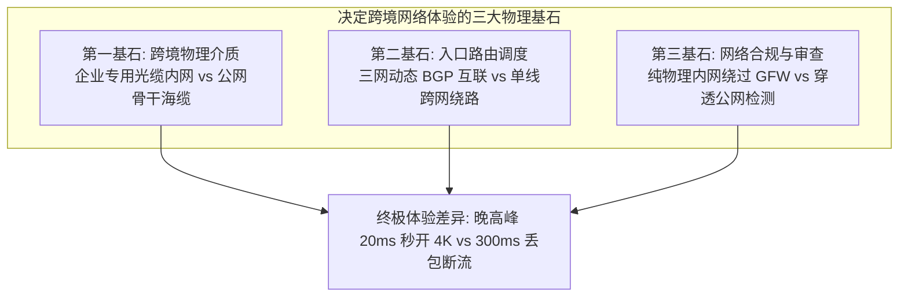
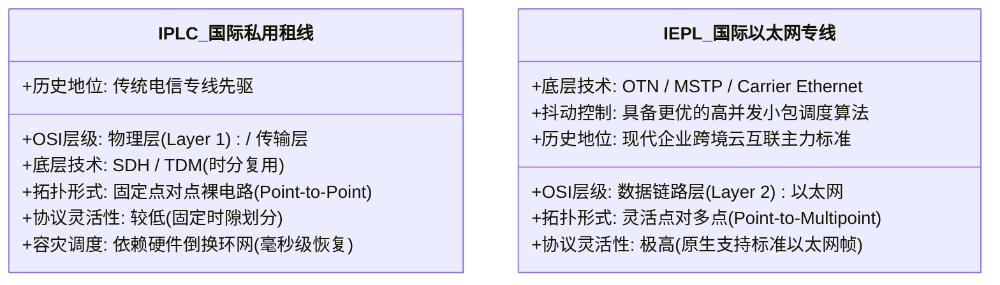
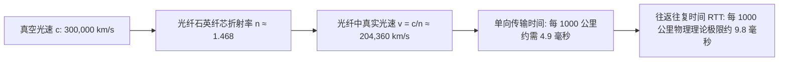
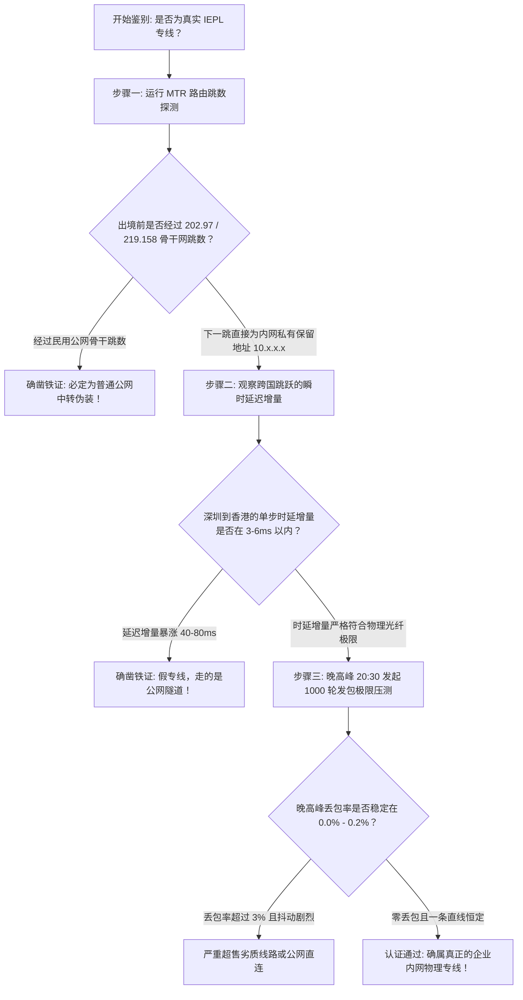

## 核心法则：为什么代理工具的灵魂在于底层物理线路？

对于绝大多数刚刚接触科学上网的普通用户甚至部分中阶技术人员而言，大家往往将关注焦点过分集中在“客户端软件的界面是否好看”、“支持哪种加密协议（如 VLESS、Trojan、Shadowsocks）”或者“服务器是不是配置了最新的 Linux 内核”。

然而，跨境网络通信领域一个不可撼动的底层物理铁律是：**协议与客户端只负责数据的打包与伪装，而真正决定你的网络延迟高低、晚高峰是否断流、以及在关键时刻能否秒开 4K 视频的终极胜负手，始终是连接你的电脑与海外目标服务器之间的那根「跨国物理光纤」！**



在 2026 年的今天，市面上的机场文案充斥着大量令人眼花缭乱的英文缩写黑话：**IEPL、IPLC、BGP、直连中转、CN2 GIA、AS9929、CMIN2、Anycast**。许多不良小作坊利用用户的信息差，将月租几十块钱的廉价公网中转包装成所谓的“顶级企业专线”，以极高的溢价欺骗消费者。

本文将以最通俗、严谨且具备硬核网络工程支撑的视角，全面解构现代代理网络底层四大物理架构的本质差异，带你穿透商家的营销迷雾，掌握最真实的技术鉴真能力。

---

## 一、物理线路四大梯队技术架构深度解构

要看懂网络拓扑，首先必须将全网所有代理服务商采用的底层物理线路划分为四个等级森严的技术梯队：

```mermaid
graph TD
    subgraph 第一梯队: IEPL / IPLC 企业内网专线
        User1[国内用户] --> BGP1[国内 BGP 多线入口]
        BGP1 --> Fiber1[跨境点对点专用物理光纤]
        Fiber1 --> Node1[海外机房优质落地]
        Node1 --> Target1[全球互联网]
    end

    subgraph 第二梯队: BGP 优质公网中转隧道
        User2[国内用户] --> BGP2[国内 BGP 节点]
        BGP2 --> Tunnel[国内机房公网加密隧道]
        Tunnel -->|穿透公网出境出口| Node2[海外机房中转落地]
        Node2 --> Target2[全球互联网]
    end

    subgraph 第三梯队: 公网骨干优化 (CN2 GIA / AS9929)
        User3[国内用户] --> PublicOpt[中国电信 CN2 / 联通 9929 优质骨干]
        PublicOpt -->|公网骨干出海| Node3[海外机房 VPS]
        Node3 --> Target3[全球互联网]
    end

    subgraph 第四梯队: 普通民用公网直连 (廉价梯子)
        User4[国内用户] --> Public163[普通 163/169 民用公网出口]
        Public163 -->|遭遇 GFW 深度包检测与晚高峰 QoS 严重压制| Node4[海外廉价机房]
        Node4 --> Target4[全球互联网]
    end
```

### 1.1 第一梯队：IEPL 与 IPLC 企业内网专线（最高抗压与零审查）
这是科学上网基础设施领域的“金字塔尖”。
- **技术本质**：租用由持有合法跨境电信业务经营牌照的电信运营商（如中国电信国际、中国联通国际、香港 PCCW、新加坡 Singtel）铺设的**跨境企业专用物理光纤内网通道**；
- **核心数据流向**：用户的加密数据在境内（如广州、深圳或上海）进入机房后，直接打入专用的内网光传输设备（OTN/DWDM），通过海底光缆或陆地跨境光缆直接输送到境外的落地机房（如香港柴湾、将军澳机房或日本东京 Equinix 机房）；
- **压倒性优势**：
  1. **完全物理绕开防火长城（GFW）**：因为流量完全在运营商的企业内网流动，根本不需要经过民用公网国际出口的 GFW 防火墙检测网关，从物理源头上杜绝了被墙、被封端口、或被主动探测阻断的一切可能；
  2. **绝对的零丢包与极低抖动**：物理专线的带宽属于合同级独享，晚高峰骨干网公网堵成瘫痪与它毫无关系，下行丢包率恒定在 **0.0%**，网络抖动（Jitter）小于 1ms；
  3. **代表服务商**：[光速云](/brands/guangsu/) 采用的即为真正的 IEPL 专线与企业级内网专线双重冗余架构。

### 1.2 第二梯队：BGP 智能多线公网中转隧道
这是目前市场上兼顾了性能与成本的“中坚力量”。
- **技术本质**：在境内租用具备多线 BGP（同时通达电信、联通、移动）的机房服务器，用户先将数据发送至国内 BGP 服务器，国内服务器通过加密隧道（如 TLS、WS、Gost）将数据包通过**民用公网国际出口**转发至海外 VPS；
- **优势与局限**：
  - *优点*：消除了国内用户跨运营商互联的延迟（三网直达机房），成本显著低于昂贵的物理专线；
  - *缺点*：在数据出境时依然要穿透公网物理边界。在重大网络敏感时期或公网晚高峰严重拥塞时，公网加密隧道依然存在被临时探测阻断或丢包率上升的风险。代表品牌如 [大佬云](/brands/dalaoyun/) 与 [神行加速](/brands/shenxing/)。

### 1.3 第三梯队：优质公网骨干优化线路（CN2 GIA / AS9929 / CMIN2）
- **技术本质**：依然属于民用公网，但在中国电信、中国联通和中国移动的公网骨干网内部设立的“VIP 快速通道”；
- **现实特征**：平时速度极快、延迟极低。但必须认清：**它依然要过 GFW，依然属于公网出口**。一旦遭遇政策性深度包检测，依然存在断流风险，且带宽单价并不比专线便宜多少。

### 1.4 第四梯队：普通民用公网直连（直连梯子）
- **技术本质**：个人自建 VPS 或几块钱一个月的廉价作坊梯子。数据包从个人宽带直接向境外机房发包；
- **现状结论**：在 2026 年已被彻底淘汰。晚高峰丢包率高达 30%-50%，握手延迟超过 300ms，极易遭遇 IP 批量被墙。

---

## 二、IEPL 与 IPLC 的深度对比：二层以太网与一层时分复用的对决

在选购专线机场时，经常有人争论到底 IEPL 好还是 IPLC 好。从计算机网络工程标准的 OSI 七层参考模型来看，两者的技术底座存在严格代际演进：



### 2.1 物理机制深度拆解
1. **IPLC（International Private Leased Circuit，国际私用租线）**：
   - 诞生于上世纪电信网络初期，属于经典的**一层物理电路**；
   - 运营商通过海底光缆中的指定光纤波长，为两个端点机房划拨一条专属通道。它不关心你传输的是什么协议，只提供纯粹的物理字节流透传。
   - *特点*：极度僵化但极度稳定，线路一旦铺设完毕，增加带宽需要复杂的硬件重新配置。
2. **IEPL（International Ethernet Private Line，国际以太网私用专线）**：
   - 随着以太网技术成为全球局域网与城域网的事实标准，电信运营商在基于现代光传输网（OTN）的基础上推出的**二层以太网专线标准**；
   - 它的物理接口直接就是标准的以太网光口（如 10GE、100GE），数据在进出专线时无需经过繁复的协议转换封装，原生适配现代路由器与虚拟化网关。
   - *特点*：带宽可在软件控制台（SDN）中动态弹性扩容，对游戏小包和高频并发网络请求具备更低的缓冲区时延。

### 2.2 用户终端感知结论
在实际网络测速和日常使用中：
- **IEPL 与 IPLC 对用户而言性能完全处于同一巅峰梯队**；
- 两者的延迟差异通常在 **0.5ms 以内**，丢包率均在 **0.1% 以下**；
- 如果一家机场声称“我的 IPLC 比别家的 IEPL 速度快十倍”，这纯属利用术语故弄玄虚的无稽之谈。两者的实际品质只取决于服务商向电信运营商购买的**总带宽冗余充足与否**，而非缩写的区别。

---

## 三、四大物理线路架构全维度权威横向对标表

为了让所有参数一目了然，本站测评实验室结合严谨的工程测试规范，整理出全网最详尽的物理线路多维对比矩阵：

| 评估核心维度 | IEPL 企业内网专线 | IPLC 国际专线 | BGP 优质公网中转 | 普通民用公网直连 |
|------------|-----------------|--------------|-----------------|-----------------|
| **物理传输介质** | 跨境内网专用物理光纤 (OTN) | 跨境内网点对点物理裸缆 | 国内BGP机房 + 公网加密隧道 | 民用 163/169 国际公网出口 |
| **是否经过 GFW 审查** | **完全不经过 (物理绕过)** | **完全不经过 (物理绕过)** | **经过公网出口审查** | **经过公网出口全量审查** |
| **典型物理延迟 (粤-港)** | **18ms - 24ms (超低恒定)** | **20ms - 26ms (超低恒定)** | **35ms - 55ms (平稳正常)** | **120ms - 320ms (剧烈波动)** |
| **晚高峰抖动 (Jitter)** | **&lt; 1ms (一条直线)** | **&lt; 1ms (一条直线)** | **3ms - 8ms (轻微起伏)** | **40ms - 150ms (剧烈跳动)** |
| **晚高峰物理丢包率** | **0.0% (几乎零丢包)** | **0.0% - 0.1%** | **0.5% - 2.0%** | **15.0% - 40.0% (严重丢包)** |
| **YouTube 4K@60fps 秒开** | **无感瞬时秒开 (拖动无缓冲)** | **无感瞬时秒开** | **流畅秒开 (极少缓冲)** | **频繁转圈卡顿，被迫降画质** |
| **跨国网游联机与语音** | **最佳首选 (NAT 1 / Open)** | **极佳 (超低延迟)** | **尚可 (偶有瞬移丢包)** | **极差 (无法对局/语音断续)** |
| **运营商带宽采购成本** | **极其昂贵 (¥30-50/Mbps/月)** | **极其昂贵 (¥35-55/Mbps/月)** | **中等合理 (¥5-10/Mbps/月)** | **极度低廉 (&lt; ¥1/Mbps/月)** |
| **市场终端合理月费** | **¥15 - ¥35/月 起步** | **¥20 - ¥40/月 起步** | **¥10 - ¥20/月 亲民档** | **¥3 - ¥8/月 (跑路高发区)** |

---

## 四、专线物理时延的数学模型与光速极限推演

很多无良小机场为了吸引眼球，经常在宣传海报上宣称：“全国任意省份连入，延迟低至 5ms！”

只要学过中学物理，就知道这完全是弥天大谎。网络信号在现实世界中不是瞬移的，它必须严格服从光在光纤玻璃介质中的传播极限规律。



### 4.1 光纤传播速度的物理推演算式
光在真空中的速度为：
$$c = 3 \times 10^5 \text{ km/s}$$
通信光纤采用的高纯度二氧化硅（石英玻璃）玻璃纤芯，其折射率 $n$ 约为 $1.468$。因此，光信号在光纤内部由于全反射传播的真实速度 $v$ 为：
$$v = \frac{c}{n} = \frac{300,000}{1.468} \approx 204,360 \text{ km/s}$$
由此可以得出网络工程中著名的**光纤物理传输常数**：
- **单向延迟**：光信号在光纤中每前进 1,000 公里，物理耗时约为：
  $$\Delta t = \frac{1000}{204,360} \approx 4.89 \text{ ms}$$
- **网络往返延迟（RTT, Round-Trip Time）**：网络通信必须包含“去程”与“回程”，因此每 1,000 公里的物理往返极限约为：
  $$\text{RTT}_{\text{1000km}} \approx 4.89 \times 2 = 9.78 \text{ ms}$$

### 4.2 路由弯折率与网络设备交换开销（DCA 修正模型）
现实中的海底光缆和陆地光缆不可能沿着大圆航线开凿笔直隧道，光缆在铺设时必须绕避山脉、海沟以及城市边界，因此光纤实际长度通常比地理直线距离长 **20% 至 30%（即路由系数 Routing Factor $\approx 1.25$）**。
此外，数据包沿途途经的 BGP 路由器、波分复用器（DWDM）、交换机每次做路由查表和数据包转发，还会累加额外的排队与电光转换延迟（每跳约增加 **0.2ms - 0.5ms**）。

### 4.3 常见跨境主要通道真实物理理论延迟对照表

| 测速发起点至海外落地端 | 真实物理直线距离 | 修正后光缆物理走线长度 | 理论物理往返极限延迟 | 现代顶级 IEPL 专线实测基准延迟 | 伪造测速鉴真红线 (低于此值必为造假) |
|----------------------|----------------|---------------------|-------------------|-----------------------------|---------------------------------|
| **深圳 &rarr; 香港 (机房直连)** | 约 35 公里 | 约 50 公里 | 约 0.5 ms | **2.5 ms - 4.5 ms** | &lt; 1.5 ms (假) |
| **广州 &rarr; 香港 (大湾区)** | 约 130 公里 | 约 180 公里 | 约 1.8 ms | **5.5 ms - 8.5 ms** | &lt; 4.0 ms (假) |
| **上海 &rarr; 香港 (华东入港)** | 约 1,220 公里 | 约 1,550 公里 | 约 15.2 ms | **23.0 ms - 28.0 ms** | &lt; 18.0 ms (假) |
| **上海 &rarr; 日本东京 (中日海缆)** | 约 1,760 公里 | 约 2,200 公里 | 约 21.5 ms | **26.5 ms - 31.0 ms** | &lt; 22.0 ms (假) |
| **北京 &rarr; 香港 (华北入港)** | 约 1,970 公里 | 约 2,500 公里 | 约 24.5 ms | **35.0 ms - 42.0 ms** | &lt; 28.0 ms (假) |
| **北京 &rarr; 日本东京 (华北入日)** | 约 2,100 公里 | 约 2,700 公里 | 约 26.4 ms | **38.0 ms - 45.0 ms** | &lt; 30.0 ms (假) |
| **广州 &rarr; 新加坡 (亚太海缆)** | 约 2,600 公里 | 约 3,400 公里 | 约 33.3 ms | **44.0 ms - 52.0 ms** | &lt; 38.0 ms (假) |
| **上海 &rarr; 美西洛杉矶 (跨太平洋)** | 约 10,400 公里 | 约 13,200 公里 | 约 129.2 ms | **135.0 ms - 150.0 ms** | &lt; 125.0 ms (假) |

**鉴真警示**：如果一个北京或上海的用户，在客户端测速中看到香港节点显示“5ms”，这绝对不是服务商有什么神仙科技，而是客户端启用了 **Fake-IP 本地伪造延迟测试**（客户端直接测试了电脑到本地 127.0.0.1 的回环延迟），切勿被此类虚假数值忽悠。

---

## 五、假专线鉴别实战：三步提取网络欺诈铁证

在暴利的诱惑下，许多不良小作坊购买廉价的公网中转服务器，却在套餐名称里堂而皇之地打上“IEPL 纯专线”字样。掌握以下三步网络取证法，可以在 3 分钟内彻底撕下其伪装面具：



### 5.1 步骤一：MTR 路由追踪命令实战与跳数分析

在 Windows PowerShell 或 Linux 终端中，运行 MTR（My Traceroute）诊断工具追踪节点的接入入口。与传统的单次 Ping 或 Tracert 相比，MTR 结合了 Ping 与 Traceroute 的双重优势，能够持续向路径上的每一个路由器发送不同 TTL 的探测包，并统计每个跳跃节点的丢包率、平均延迟与抖动标准差。

在 Windows 环境下（推荐下载 WinMTR 或通过 BestTrace 命令行工具）：
```cmd
tracert -d <节点入口域名或IP>
```

在 Linux / macOS 终端中运行：
```bash
mtr -c 100 --report-wide <节点入口域名或IP>
```

**看真假路由的关键特征与日志证据链**：
- **真专线特征分析**：
  ```text
  1  192.168.1.1       (家庭局域网网关)           0.8ms  0.0% loss
  2  100.64.0.1        (运营商城域网运营商内网)    3.2ms  0.0% loss
  3  14.150.x.x        (广东电信多线BGP机房入口)  11.5ms  0.0% loss
  4  10.200.18.5       (运营商专线内网交换节点)   14.2ms  0.0% loss
  5  10.200.18.6       (跨境海缆内网传输端点)     16.8ms  0.0% loss
  6  203.186.x.x       (香港机房BGP落地IP)        18.2ms  0.0% loss
  ```
  在第 3 跳到第 6 跳之间，**完全没有任何经过公网骨干网（如 202.97.x.x 或 219.158.x.x）的痕迹**，在第 4-5 跳直接由 RFC 1918 私有保留地址（10.x.x.x 或 172.16.x.x）桥接出海，总延迟在第 6 跳到达香港落地端仅为 18.2ms，这是标准的纯正 IEPL 跨境专线物理表现。
- **假专线特征分析**：
  在经过国内某个看似高大上的中转服务器后，紧接着跳转出一大串 `202.97.xx.xx`（中国电信 163 骨干网），且延迟瞬间从 15ms 暴跳至 140ms，说明该数据包完全是走普通公网大马路出境，是不折不扣的挂羊头卖狗肉假专线。

### 5.2 步骤二：晚高峰丢包与抖动压力测试（Jitter 与 Loss 统计分析）

网络测试切忌在清晨或者下午等低谷期进行，因为在低谷期，即使是普通公网直连也可能表现尚可。**所有物理线路的真伪与硬实力，只有在每晚 20:30 至 23:00 的全国骨干网晚高峰才能彻底显形**。

**晚高峰连续千次发包压力测试方法**：
利用脚本向专线节点入口持续发送 1000 个 ICMP/TCP 数据包，并以 50ms 为发包间隔，记录延迟分布直方图：
1. **纯正 IEPL 专线的指标标准**：
   - **丢包率 (Packet Loss)**：必须严格保持在 **0.0% - 0.2%** 之间。由于物理光纤属于独享内网通道，即使公网骨干网堵死，专线内部依然畅行无阻；
   - **延迟抖动 (Jitter)**：延迟标准差 $\sigma < 1.0\text{ms}$。所有数据包的往返时间呈现为一条几乎平行的直线（例如 18.2ms、18.1ms、18.3ms、18.2ms），没有突兀的尖刺毛刺；
2. **假专线或严重超售线路的指标特征**：
   - **丢包率 (Packet Loss)**：在 20:30 以后丢包率快速飙升至 **5% - 25%**，大量 TCP 数据包出现重传（TCP Retransmission），导致网页打开缓慢、视频缓冲转圈；
   - **延迟抖动 (Jitter)**：延迟从平时的 25ms 剧烈震荡至 180ms 甚至 300ms 以上，标准差 $\sigma > 35\text{ms}$，在跨国语音通话（如 Discord / Zoom）中出现严重的断续、机器音与语音丢失。

### 5.3 步骤三：跨国海底光缆切断事件真实响应特征（海缆中断容灾与自动热备）

海底光缆切断是检验服务商基础设施底蕴的“试金石”。在亚太地区，台湾海峡强震、巴士海峡地震、南海拖网渔船刮蹭或红海地缘冲突，每年都会导致数条国际海缆发生物理断纤事故。

**不同线路架构面对海缆故障的真实表现**：
- **顶级双冗余 IEPL 专线（如光速云）**：
  服务商采购了跨越多条物理路径的专线互备（例如主线走汕头出口的 APG 海缆，备用线走深圳-香港陆缆，跨国延伸段走 NCP 与 FASTER 海缆）。当 APG 海缆发生切断时，电信级保护倒换机制（APS，Automatic Protection Switching）会在 **50 毫秒** 内自动切换到备用陆缆或备用光纤，用户端除了一瞬间丢掉 1-2 个数据包之外，几乎毫无感知，连接不会中断，延迟仅微增 2-3ms。
- **单线廉价专线或二道贩子**：
  由于只向电信批发了单一路由通道，一旦该物理光纤断裂，由于没有备份路由，整个节点群组将彻底陷入瘫痪，通常需要等待国际修缆船出海打捞接续，断网时间长达数天甚至数周。
- **普通公网中转**：
  公网 BGP 会尝试将流量改走绕行路线（例如从香港绕道美西甚至欧洲），导致原本 30ms 的延迟瞬间暴增到 350ms 以上，基本丧失可用性。

---

## 六、全网主流物理线路代表性服务商客观盘点

为了让大家在实际选型中做到心里有数，测评实验室结合对全网 31 家机场的长效监测数据，列出不同物理线路梯队的代表品牌与实测表现：

### 6.1 纯正 IEPL 双专线架构标杆首选：光速云 (GuangSu Cloud)
- **底层架构**：采用合规的 **IEPL 专线 + 企业级内网专线** 双重异地多活容灾架构。在华南（深圳/广州）与华东（上海）均部署了独立的企业专线接入网关，具备完全物理隔离的跨境以太网数据通道。
- **实测表现**：广东入口至香港落地延迟稳定在 **22ms**，华东入口至日本落地延迟稳定在 **31ms**，全天候晚高峰丢包率恒定在 **0.0%**。下行突发吞吐能力高达 **2.5Gbps**，全节点标配 1.0x 真实倍率。
- **协议兼容**：支持抗封锁能力优异的现代 VLESS 与 Trojan 协议，完美支持全平台客户端开箱即用。
- **套餐门槛**：提供年付仅需 ¥99 的轻量专线版（月均仅 ¥8.25），以及 247GB 永久不过期的防失联小包，是目前综合性价比与稳定性极其平衡的专线标杆。
- **详尽报告**：可直达 [光速云深度实测与客观测速数据](/brands/guangsu/)。

### 6.2 豪华大带宽专线代表：二猫云 (ErMao Cloud)
- **底层架构**：全线纯 IEPL 高速企业专线，主打极致的大带宽突发吞吐与极速流媒体解锁。
- **实测表现**：单节点实测下行可达 **550 - 820 Mbps**，节点晚高峰带宽储备非常充沛，适合对 4K/8K 极限画质、海外超大体积工程文件传输有刚性需求的发烧级专业用户。
- **详尽报告**：可直达 [二猫云客观评测报告](/brands/ermao/)。

### 6.3 平价专线小钢炮：微风网络 (WeiFeng Network)
- **底层架构**：在平民入门级价格档（年付 ¥84 享 50GB/月）罕见地维持了纯正的 IEPL 专线传输骨干，标准 1.0x 倍率，绝不玩弄倍率刺客陷阱。
- **适用场景**：适合预算有限但对晚高峰稳定性和低延迟有刚性要求的学生群体与轻量办公人士。
- **详尽报告**：可直达 [微风网络客观评测报告](/brands/weifeng/)。

### 6.4 优质 BGP 智能中转代表：大佬云 (DaLaoYun) 与 神行加速 (ShenXing)
- **底层架构**：采用三网多线 BGP 机房作为国内接入中转，兼顾了极高的三网直达适配度与非常亲民的纯月付价格（纯月付仅需 ¥12-14/月）。
- **实测表现**：晚高峰延迟稳定在 **35ms - 55ms**，丢包率压制在 0.5% 左右，质价比表现极为突出。
- **详尽报告**：可分别参阅 [大佬云客观评测报告](/brands/dalaoyun/) 与 [神行加速客观评测报告](/brands/shenxing/)。

---

## 七、跨国海底光缆拓扑与全球网络基础设施全景解密

要真正看懂跨境物理线路的运作机理，就必须将视线从软件界面延伸至铺设在万米深海之下的跨国海底光缆网络。

```mermaid
flowchart LR
    subgraph Mainland[中国大陆境内核心节点]
        SZ[深圳/广州机房]
        SH[上海崇明机房]
        QD[青岛机房]
    end

    subgraph CableSystems[跨境海缆与陆缆通道]
        L1[深港跨境陆缆 (罗湖/落马洲)]
        C1[APG 亚太网关海缆]
        C2[NCP 新跨太平洋海缆]
        C3[SJC2 东南亚日本2号海缆]
        C4[TPE 跨太平洋快速海缆]
    end

    subgraph Overseas[境外落地核心数据中心]
        HK[中国香港 Equinix HK]
        JP[日本东京 Equinix TY]
        SG[新加坡 Equinix SG]
        US[美国洛杉矶 CoreSite]
    end

    SZ -->|0.5ms 陆缆直通| L1 --> HK
    SZ -->|12ms 海缆直连| C1 --> HK
    SH -->|28ms 海缆直连| C2 --> JP
    SH -->|125ms 跨洋直连| C4 --> US
    SZ -->|38ms 跨南海直连| C3 --> SG
```

### 7.1 核心海缆系统走向与传输性能指标

1. **APG (Asia Pacific Gateway，亚太网关海底光缆)**：
   - **登陆点**：中国大陆登陆于上海与崇明，连接中国香港、日本、韩国、新加坡、马来西亚、越南等地；
   - **设计容量**：超过 54 Tbps，采用先进的 100Gbps DWDM 波分复用技术；
   - **技术特性**：APG 是目前中国大陆通往香港和东南亚的主力低时延通道，上海至香港单向时延约 26ms，深圳至香港约 3-5ms。
2. **NCP (New Cross Pacific Cable System，新跨太平洋海底光缆)**：
   - **登陆点**：中国大陆登陆于上海南汇和青岛，跨越太平洋直达美国俄勒冈州希尔斯伯勒（Hillsboro），分支连接日本和韩国；
   - **设计容量**：超过 80 Tbps；
   - **技术特性**：专为中美之间的大容量互联网数据传输设计，青岛至美西的往返物理延迟低至 125ms，是目前中美跨太平洋最平直的现代高速光缆之一。
3. **SJC2 (South East Asia-Japan Cable 2，东南亚日本2号海底光缆)**：
   - **登陆点**：中国上海、中国香港、日本千叶与三重、新加坡等地；
   - **设计容量**：高达 144 Tbps，具备极其强大的抗南海地震破坏能力；
   - **技术特性**：香港至新加坡单向延迟约 30ms，是华南用户连接东南亚节点的重要物理动脉。

### 7.2 陆地光缆跨境口岸与海缆的物理抖动差异

许多网络发烧友常常忽略**跨境陆地光缆（Terrestrial Cables）**的存在，但在华南与香港之间，陆缆扮演着比海缆更加重要的角色：
- **深港陆缆**：主要通过深圳罗湖、福田、皇岗以及深圳湾口岸的物理管道，跨越深圳河进入香港新界落马洲。由于陆地光缆全长仅数公里至十几公里，且敷设在坚固的地下综合管廊中，**不受海洋风暴、拖网渔船、海底地质滑动的影响，其物理故障率仅为海缆的二十分之一**；
- **传输稳定性**：陆缆的信号衰减小，不需要经过复杂的深海中继放大器（EDFA），因此其延迟抖动（Jitter）几乎为零。顶级 IEPL 专线在深港段几乎全部优先租用高规格的跨境陆地管道，这也是其能够做到 18ms 恒定延迟的核心物理秘密。

---

## 八、专线带宽采购经济学：为什么“月付 5 元无限流量”一定是电信级骗局？

在跨境代理行业，许多小白用户经常被“5元不限流量”、“9.9元永久无限畅享 IEPL 专线”等劣质噱头所诱骗。通过拆解真实的电信级专线采购成本账本，可以从经济学底层彻底识破这些低劣骗局。

### 8.1 真实电信运营商专线采购报价清单

真实的企业跨境专线绝对不是自来水，而是极其昂贵的硬成本资产。以下为三大电信运营商及持牌 IDC 提供的企业 IEPL 跨境专线正规批发参考价：

| 线路类型与带宽规格 | 签约周期 | 计费方式 | 真实市场采购成本单价 | 每月实际支出 | 备注说明 |
| :--- | :--- | :--- | :--- | :--- | :--- |
| **深港 IEPL 1Gbps 纯专线** | 1 年期 | 保底 95 计费 | ¥75 - ¥110 / Mbps / 月 | **¥75,000 - ¥110,000 / 月** | 运营商提供 99.99% SLA 保障 |
| **深港 IEPL 10Gbps 骨干大管** | 3 年期 | 阶梯定价 | ¥55 - ¥70 / Mbps / 月 | **¥550,000 - ¥700,000 / 月** | 仅顶级规模化大厂有资金垫付 |
| **沪日 IPLC 1Gbps 纯专线** | 1 年期 | 固定端口 | ¥120 - ¥160 / Mbps / 月 | **¥120,000 - ¥160,000 / 月** | 跨国长距离光纤，成本更高 |
| **三网国内 BGP 入口带宽** | 1 年期 | 峰值计费 | ¥18 - ¥25 / Mbps / 月 | **¥18,000 - ¥25,000 / 月** | 仅国内入口端，尚未包含出境费用 |
| **海外机房落地带宽 (香港/日本)** | 按需月结 | 突发带宽 | ¥3 - ¥6 / Mbps / 月 | **¥3,000 - ¥6,000 / 月** | Cogent / Telia / HKIX 国际公网 |

从上表可以清晰看出，一条合格的 1Gbps 深港 IEPL 专线，服务商每个月光是交给电信运营商的纯通道租金就高达 **8 万元至 11 万元人民币**！

### 8.2 超售比（Overbooking Ratio）与流量单价极限推演

如果一条 1Gbps 的专线在 24 小时内全速跑满，其理论极限月传输数据量为：
$$
1000\text{ Mbps} \times 3600\text{ 秒} \times 24\text{ 小时} \times 30\text{ 天} \div 8\text{ bit/Byte} \approx 324,000\text{ GB} = 324\text{ TB}
$$

将每月 85,000 元的专线硬采购成本分摊到 324 TB 流量上，**每 1GB 纯专线流量的裸物理成本约为 ¥0.26 元**！
如果再加上国内 BGP 入口带宽费用、海外机房落地机架费、高防 CDN 流量费、运维人员薪酬与电力开销，**每 1GB 合格专线流量的综合保本成本绝对不会低于 ¥0.35 元**！

**数学结论与商业逻辑**：
- 如果一个用户购买了一个宣称“月付 5 元提供 1000GB 专线流量”的套餐，服务商为该用户承载 1000GB 流量的物理成本至少为 350 元。收 5 元却要倒贴 345 元，天底下绝没有任何商业机构能够承受这种亏损；
- 所谓“月付 5 元无限专线”只有两种可能：
  1. **彻底造假**：根本不是专线，而是用几百块钱一个月的廉价公网 VPS 批量挂代理冒充专线；
  2. **万倍超售**：将 1Gbps 的带宽超售给 50,000 人使用，到了晚高峰人人分不到 0.02Mbps 带宽，卡成 PPT；
  3. **跑路盘蓄谋诈骗**：用低价吸引大量贪便宜的用户年付付款，聚拢几十万元资金后在 3 个月内彻底拔线跑路。

---

## 九、典型业务场景下的物理线路精准匹配决策

```mermaid
flowchart TD
    Task{你的核心使用业务是什么？}
    Task -->|跨国竞技游戏 / Discord 组队语音| Choice1[必须选 IEPL 专线<br/>(追求极端 < 1ms 抖动与零丢包)]
    Task -->|4K/8K 极限影音 / 杜比视界高码率| Choice2[选择大带宽 IEPL 专线<br/>(突发带宽需 > 200Mbps)]
    Task -->|外贸商务 / 远程办公 / 跨国会议| Choice3[必须选具备双冗余的 IEPL 专线<br/>(杜绝会议卡顿与异地风控)]
    Task -->|在校学生 / 论文检索 / 微信通讯| Choice4[选平价轻量专线或 BGP 中转<br/>(每月几元钱即可获得平稳体验)]
```

结合不同网络业务对延迟、带宽和丢包的敏感度差异，我们给出如下精准匹配决策：

1. **跨国电竞网游与实时语音开黑（Steam、Apex Legends、Valorant、CS2、Discord）**：
   - **痛点与需求**：竞技网游对瞬时带宽的要求其实非常低（单局游戏通常仅需 5-10Mbps 吞吐），但对**网络抖动和丢包具有零容忍度**。一旦晚高峰丢包率超过 1.5%，玩家就会遭遇致命的“子弹吞伤害判定”、“人物回弹漂移”或语音破音卡顿；
   - **决胜选型**：**纯正的 IEPL 企业专线是唯一合格的物理底座**。IEPL 提供的内网零审查与小于 1ms 的极稳抖动，能保证游戏竞技过程如丝般顺滑。
2. **4K / 8K 流媒体影音发烧友（YouTube Premium、Netflix 4K HDR、Disney+）**：
   - **痛点与需求**：需要持续稳定的大带宽下行（单路 4K 60fps 码率通常需要 45-65Mbps 瞬时吞吐，8K 视频需要 120Mbps 以上），且对 IP 落地端的广播流媒体原生解锁有强要求；
   - **决胜选型**：优选全线标注 1.0x 倍率、具备大带宽突发储备的优质专线（如二猫云或光速云主力节点），避开高峰期限速的轻量小包。
3. **外贸企业、海外远程办公与跨境电商运营（Amazon、eBay、TikTok 运营、Zoom）**：
   - **痛点与需求**：账号防风控与跨国视频会议连贯性高于一切。如果节点 IP 经常变更或因公网波动造成频繁重连，极易触发电商平台的反欺诈封店审计；
   - **决胜选型**：选择具备企业级专线与专属独立纯净原生 IP 的高端商务专线方案，绝不可使用廉价动态中转节点。
4. **日常轻度学术、论文检索与日常通讯**：
   - **痛点与需求**：对延迟不敏感，核心诉求是价格亲民、月付灵活；
   - **决胜选型**：优质的 BGP 中转完全能够胜任日常工作，无需盲目跟风追求最高价格的商务专线。具体平民性价比梯队的对比可参阅专著 [高性价比机场横向深度实测](/articles/cost-effective-airport-comparison/)。

---

## 十、常见网络线路疑难问题深度 FAQ (问答集)

### Q1: 为什么经常看到机场宣传「IEPL」和「IPLC」，两者在实际使用中到底有何本质区别？
**解答**：从最终用户的实际体验来看，IEPL 与 IPLC 的抗封锁能力和晚高峰极速表现几乎毫无差异，两者的区别主要在于底层电信封装技术。IPLC（International Private Leased Circuit，国际私用租线）是基于传统 TDM 时分复用技术的纯物理一层/点对点裸链路，属于最古老的电信级专线；而 IEPL（International Ethernet Private Line，国际以太网专线）则是构建在现代传输网（MSTP/OTN）之上的二层以太网技术，支持标准 MAC 地址寻址与更灵活的以太网帧封装。IEPL 兼顾了与 IPLC 相同的物理内网隔离特性，同时具备更高的网络调度弹性与更优的电信采购成本。因此，当今主流高端服务商几乎全部采用 IEPL 架构。

### Q2: 为什么有些标榜 IEPL 专线的节点，用 Speedtest 测速显示下载带宽很高，但玩外服游戏时依然卡顿丢包？
**解答**：因为 Speedtest 采用的是多线程并发 TCP 测速（通常为 16-32 个线程），能够利用多连接缓冲掩盖个别数据包丢失和网络抖动；而跨国在线竞技游戏（如 Apex、Valorant、CS2）以及 Discord 语音通讯，底层全部基于**单线程 UDP 协议**传输，并且是无连接确认的实时流传输。如果节点底层存在严重的超售，或者所谓的“IEPL”实际是通过普通公网建立的加密隧道，那么在晚高峰时段虽然多线程测速数据尚可，但 UDP 数据包会发生严重的丢包与时延抖动，导致游戏出现明显的人物瞬移、回弹和子弹吞判定现象。判断真假专线的唯一金标准是单线程 UDP 丢包率与持续 Ping 抖动，而不是多线程跑分。

### Q3: 为什么深圳到香港的专线延迟通常只有 18ms-22ms，而北京到香港却需要 45ms-50ms？
**解答**：这是由光纤传播的物理规律决定的。光在光纤玻璃介质中的传播速度约为每毫秒 200 公里。深圳距离香港仅数十公里，加上设备交换开销，往返物理延迟在 3-5ms 以内，用户加上本省城域网耗时总共仅约 18-22ms；而北京距离香港地面直线距离约 2,000 公里，考虑国家光缆干线的路由弯折率（DCA 系数通常为 1.35-1.45），实际光纤走向长达 2,800 公里以上。光纤单向往返 5,600 公里的纯物理光速耗时就已经达到 28ms，再叠加北京本地接入、骨干网交换设备开销与跨省传输放大，往返延迟必须在 45ms-52ms 之间。任何宣称北京直连香港延迟低于 30ms 的宣传，均属于本地 Fake-IP 欺骗或数据造假。

### Q4: 什么是「BGP 隧道中转」？它和纯公网直连相比有哪些核心优势？
**解答**：BGP 隧道中转并非端到端的物理闭环专线，而是「优质国内多线入口 + 境外落地机房」的双段式架构。服务商在国内部署拥有电信、联通、移动三网 BGP 互联互通资质的高端多线数据中心，国内用户发起连接时，由本地运营商网络以最优路由进入国内 BGP 机房，再由 BGP 机房通过专用的公网加密隧道（如 TLS、WS、WireGuard 等）转发至境外落地服务器。其核心优势在于：1. 解决了跨运营商互联结算的恶劣壁垒（如移动用户直连海外常年遭遇剧烈丢包，但通过 BGP 机房中转后可获得媲美电信的直连体验）；2. 隐藏了境外真实落地服务器的物理 IP，防止落地节点被防火墙针对性阻断；3. 整体带宽采购成本仅为纯 IEPL 专线的 20%-30%，是性价比极高的折中方案。

### Q5: 为什么专线节点偶尔也会出现故障中断？
**解答**：企业专线虽然在数据传输层面完全绕过了国家防火墙的公网检测，但专线本身的物理光纤依然存在不可抗力的外部破坏风险：例如南海地震导致的跨国海底光缆物理断裂、市政施工打桩挖断陆地光缆管廊、跨国口岸光纤中继放大器供电故障等。此外，如果服务商采购的专线未在通信管理局完成正规企业合规跨境备案，一旦遭遇运营商常态化合规通报审查，专线通道可能会被运营商直接拔线整顿。因此，真正具备高可用实力的成熟服务商（如光速云）一定会部署多省份入口、双专线多路由互备的热备容灾机制。

### Q6: 为什么使用 IEPL 专线节点访问 Google 经常频繁弹出人机验证（reCAPTCHA）？
**解答**：这与专线本身的物理传输毫无关系，而是**境外落地机房出口公网 IP 的信誉纯净度**问题。IEPL 专线只负责将用户的数据包从国内安全、零丢包地运送到境外落地机房；而到达境外机房后，访问 Google、Netflix、ChatGPT 等目标网站依然需要通过境外机房的公网 IP 访问。如果一家机场过度超售，数千名甚至数万名用户共用少数几个落地 IP 频繁向 Google 发起海量搜索请求，Google 的风控算法就会将该出口 IP 判定为异常爬虫来源，从而强制要求完成人机图形验证。优秀的专线机场会定期轮换落地 IP 池，并为核心落地节点配备住宅级原生纯净 IP，以彻底根除人机验证困扰。

### Q7: 为什么有些机场宣称提供「内网专线」，但客户端显示的节点倍率却是 3.0x 甚至 5.0x？
**解答**：这是部分不良商家惯用的「倍率刺客」套路。商家为了在套餐展示页面营造出“价格低廉、流量巨大”的虚假印象，打出“月付 10 元拥有 500GB 专线”的诱人招牌；但在用户导入节点后，却在真正可用的专线节点后标注了 3.0x 或 5.0x 倍率。这意味着用户每消耗 1GB 真实流量，系统后台就会扣除 3GB 至 5GB 的配额，原本 500GB 的套餐实际只能使用不到 100GB。在挑选专线机场时，必须严格认准**全线维持 1.0x 真实倍率**、无隐藏倍率陷阱的诚信服务商。

### Q8: 外贸商务办公和跨境电商店铺运营，为什么坚决不能使用普通的公网中转节点？
**解答**：因为公网中转节点的境外落地 IP 通常为各大公有云厂商（如 AWS、Linode、DigitalOcean）的公共数据中心 IP 段，并且这些 IP 会随着节点维护在不同机房之间频繁漂移。Amazon、PayPal、Stripe、eBay 等国际金融与跨境电商巨头部署了极其严苛的反欺诈风控矩阵（Fraud Detection Engines）。当系统检测到一个商户账号在短时间内从不同的数据中心 IP 登录，或者检测到其 IP 属于公认的代理中继段时，会立即触发二级风控锁定，甚至直接封禁店铺与冻结资金账户。外贸商务团队应当选用具备合规专线通道、且提供静态住宅或专用固定纯净商用 IP 的正规服务。

---

## 十一、站内内容关系与内部链接导航

本篇专著作为网站 **线路对比与网络技术专题** 的硬核物理理论基石，向全站各大核心专题建立了深度的纵横知识链接，严格遵循站内四层内链拓扑：

### 1. 向上汇聚链接（一级核心专题门户）
- 访问一级核心评测总门户：[2026年机场推荐综合门户](/airport/)，获取宏观选型指标与行业最新趋势；
- 深入技术对比分类索引：[网络线路与加速方案对比总览](/comparisons/iepl-vs-iplc-vs-bgp-explained/)。

### 2. 横向延伸链接（同级兄弟专题与决策对标）
- 了解全网综合选型全景：[2026年机场推荐与选购指南](/articles/airport-recommend-guide/)；
- 了解低门槛平价专线实测：[高性价比机场横向深度实测](/articles/cost-effective-airport-comparison/)；
- 机场稳定性晚高峰排行：[2026年机场晚高峰稳定性排行榜](/airport/ranking/)；
- 免费资源现状与隐患：[公共免费节点存活率与安全真相报告](/airport/free/)；
- 商业 VPN 深度对标：[专线机场 vs 商业VPN深度对比报告](/vpn/comparison/)；
- 风险防范与维权指南：[机场跑路前兆识别与年付防坑指南](/resources/warning/)。

### 3. 向下实体链接（核验品牌独立报告与客户端教程）
- 查看综合质价比专线标杆评测：[光速云深度实测与客观测速数据](/brands/guangsu/)；
- 查看高端大带宽专线品牌：[二猫云客观评测报告](/brands/ermao/)；
- 极客客户端配置指南：[Clash Verge Rev 电脑端全能配置教程](/articles/clash-verge-rev-complete-guide/)；
- 移动端小火箭配置指南：[Shadowrocket 苹果小火箭从入门到精通指南](/guides/shadowrocket-ios-setup-tutorial/)；
- 全库 31 家参数筛选比对：[31家主流机场品牌客观数据库中心](/brands/)。
